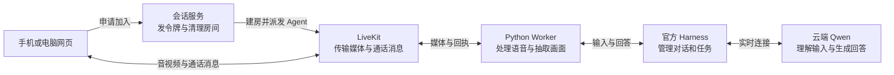

# LiveKitAgent 项目导航

LiveKitAgent 已形成可从手机网页和鸿蒙 Demo 接入的视觉语音通话。当前产品主线是 **`qwen_live_official`**，支持视觉问答、持续讲解、分步教学、条件提醒和通话内视觉记忆。 [长期运行和 App 接入](#长期运行和-app-接入)

## 代码目录与边界

| 归属 | 目录 | 从哪里看 |
| --- | --- | --- |
| Web 客户端 | `web/src/` | `main.js` 串起通话界面、设备与会话。局域网使用 LiveKit SDK，跨城试用由 `browser-trial.js` 走 WSS，`capture.js` 在浏览器里采集 PCM。 [网页入口](web/src/main.js) |
| 鸿蒙客户端 | `harmony-demo/` | ArkWeb 加载 Web 通话页，鸿蒙工程负责权限、服务地址和原生界面。 [鸿蒙入口](harmony-demo/entry/src/main/ets/pages/Index.ets) |
| Python 服务端 | `src/livekit_vlm_agent/` | `api.py` 和 `session.py` 管理会话，网关处理客户端连接，`worker.py` 接收 LiveKit 派发并调用官方 Worker。 [会话 API](src/livekit_vlm_agent/api.py) · [Worker](src/livekit_vlm_agent/worker.py) |
| Node 服务端 | `harness/qwen-live/src/` | Python Worker 启动 `bridge.mjs`，经标准输入输出与它通信。运行时管理对话、场景任务和通话记忆，连接云端 Qwen。 [桥接入口](harness/qwen-live/src/bridge.mjs) · [运行时](harness/qwen-live/src/runtime.mjs) |
| 自动化测试 | `tests/`、`web/tests/`、`harness/qwen-live/test/` | 分别放 Python、浏览器和 Node 测试。隔离 RTC 验证使用本机 LiveKit 和模拟模型。 [测试 Worker](tests/official_fixture_worker.py) · [验证命令](README.md#回归验证) |
| 开发和部署工具 | `scripts/`、`config/` | 启动、停止、构建和探针脚本从这里调用对应模块。隔离联调由 `verify_official_harness.py` 启动测试服务和浏览器。 [联调入口](scripts/verify_official_harness.py) |

浏览器和鸿蒙通过 HTTP、WSS 或 LiveKit 协议使用服务。测试依赖被测模块，运行时代码的依赖留在各自的客户端或服务端目录。设备检查、手机测试采集和复盘是诊断功能，分别由 Web 页面和服务端接口实现。

## 先看这张图



图中是当前主线。**LiveKit 负责传输，Harness 负责安排何时回答、观察或提醒，Qwen 负责理解和生成。** 手机的本地 HTTPS 网关提供网页和信令入口。

为新视界原生接入准备了独立 WSS 网关。模拟网关用于开发原生入口，真实网关代表 App 加入现有 LiveKit 房间。连接契约、两种启动方式和真机验收步骤见 [新视界鸿蒙通话网关协议 v1](docs/harmony-gateway-v1.md)。

跨城浏览器试用入口复用手机全屏通话页，试用码授权后通过 WSS 传输音视频和任务操作。支持持续讲解、分步教学、提醒和百炼通话内记忆。「更多功能」可以打开任务与对话。由 `scripts/start-remote-trial.ps1` 独立启动。公网接入和验收见 [跨城试用](docs/harmony-gateway-v1.md#7-跨城浏览器试用)。

独立鸿蒙 Demo 通过 ArkWeb 加载同一全屏通话页，提供可保存的 HTTPS 服务地址、加载重试和原生权限申请。工程、构建和试用分发入口见 [HarmonyOS Demo](harmony-demo/README.md)。

## 一次普通视频问答

1. 网页取得麦克风权限，向会话服务申请加入。会话服务创建 LiveKit 房间，派发 Agent，并给网页房间令牌。
2. 网页和 Worker 加入房间。Worker 启动官方 Harness，等模型连接就绪后报告接通。网页随后发布麦克风，用户打开摄像头后再发布视频。
3. 例如用户对着杯子问「这是什么？」Worker 接收语音，并从视频里抽取较新的画面。Harness 把输入发给 Qwen，由 Qwen 理解并生成回答。
4. 回答经 Worker 和 LiveKit 数据通道送回网页。网页播放语音、显示文字，并回报播放状态。挂断时，会话服务和 Worker 清理房间及模型连接。

## 运行模式

官方 Harness 是唯一运行模式。旧的 M2、自研控制和独立文字观察可从 Git 标签 `pre-official-only` 复现。当前可用 `MODEL_PROVIDER` 选择提供商，并通过 `QWEN_LIVE_PROACTIVE_ENABLED` 和 `QWEN_LIVE_MEMORY_ENABLED` 配置主动任务及通话内记忆。

Web 开发首页、设备检查、手机复盘页和探针仍用于联调。正式用户入口可以复用全屏通话页。部署时将复盘读取、诊断和调试入口留在内部，生产环境关闭测试采集。

## 当前证据

- **已实现的能力**包括普通视觉问答、主体讲解与点选纠正、分步教学和条件提醒。
- 百炼官方模式默认启用通话内记忆。近期帧和较早的视觉摘要，与用户转写、任务状态和播放回执共用通话时间线。回忆可按时间、任务、事件或上轮范围检索。挂断时清空，可用 `QWEN_LIVE_MEMORY_ENABLED=false` 关闭。 [记忆设计与验证](docs/official-memory-design.md)
- 持续讲解中，点选用于纠正当前主体。确认后恢复普通的自动切换规则，原物品退到背景时也可以切到明确展示的新主体。
- 持续讲解和教学共用启动语音处理。明确的启动请求由任务播报首段内容，普通问答和同轮其他工具结果继续按对话处理。
- 用户明确说稍后或接下来展示时，讲解任务先准备连接和取帧，等局部画面变化后稳定约 250 毫秒再提交两帧。已在画面的物品可直接检查；无明显变化时约 4 秒做首次兜底检查，空结果后相同画面约每 6 秒检查一次。首个主体确认后进入普通讲解观察。
- 自动主体在同一组的两帧里都只剩小块边角时，清除旧主体并撤销待播讲解，随后重新搜索。
- 固定镜头或相同背景下也能快速换物。同一组两张新帧都能明确确认旧物离开，并显示位置稳定且突出的新物时，可直接切换。遮挡、证据不明确或新物不突出时仍需复核。
- 正式教学步骤由任务调度播报。明确的口头完成确认对应用户开口时的步骤，和视觉确认同时发生也只推进一次。当前步骤的追问继续由前台回答。
- 明显转镜头时开启最长 2 秒的 4 FPS 本地采样，距最后一次明显变化至少 250 毫秒后可恢复识别，每次模型观察仍使用两帧。自动主体与已讲内容在换景时清除，显式语音指定的主体继续沿用原规则。教学保持两次新画面确认，检测到局部变化并停稳后可将普通检查间隔从 4 秒缩至 2 秒。细微变化可能仍走普通检查，手机实测延迟和误判率待验收。
- **单模式清理版验证**通过 Python 46 项、Harness 74 项和 Web 5 项测试，以及锁定依赖安装和前端构建。隔离 RTC 联调使用本机 LiveKit 和模拟模型，覆盖直连讲解、浏览器试用、教学、提醒、鸿蒙 WSS、复盘和取消接通。记忆的协议回归使用模拟数据；真实模型和鸿蒙真机本轮未复测。
- **服务化验收**还需覆盖候选发布版在真机上的自然交互、弱网、持续运行、故障恢复、多用户并发和成本。初期人工体验与该验收分开记录。
- **百炼模型访问已由项目维护者确认恢复。** 先前的 `AccessDenied.Unpurchased` 是历史验证记录。 [讲解验证记录](docs/guide-fast-response.md)

## 运行与排查入口

已有依赖和本地配置时，在项目根目录用 PowerShell 构建网页，再启动官方 Harness 桌面通话。 [启动器](scripts/run_local.py)

```powershell
npm.cmd run build --prefix web
.\.venv\Scripts\python.exe .\scripts\run_local.py --official-proactive
```

桌面默认地址是 `http://127.0.0.1:8000`。手机官方模式用 `.\scripts\start-qwen-live-mobile.ps1`，启动后访问已准备好的手机 HTTPS 地址。新环境另需安装锁定的官方核心依赖 `npm.cmd ci --prefix harness/qwen-live --ignore-scripts`。通话服务可用 `Ctrl+C` 或 `.\scripts\stop-local.ps1` 停止。 [手机接入准备](docs/mobile-device-check.md)

手机体验页在同一个 HTTPS 地址后加 `/?view=call`，摄像头开启后可拖动 AI 小窗、轻点画面收起或恢复控件。持续讲解时，从右上角「更多功能」选择「选择主体」，再轻点一次要讲解的物品，随后轻点画面恢复为切换控件。首页 `/` 继续用于开发测试，显示详细步骤和错误。两页共用 [网页通话入口](web/src/main.js)。

**手机测试复盘。** 加入前勾选「记录本次测试」，通话中可按「标记问题」。挂断后，用电脑浏览器打开 `http://127.0.0.1:8000/mobile-test-report.html`（端口与 API 一致），根据手机显示的编号选记录。整场时间轴可切换「音视频」和「系统动作」，问答和问题标记在两种视图中共用时间位置。悬停预览，点击查看证据，放大后可拖动时间窗口。点图可打开实际交给 Harness 的 JPEG，视觉判断和记忆证据会引用对应帧。报告存放在 `.runtime/mobile-tests/<测试编号>/`，含画面、转写和记忆正文。可按目录移除旧测试，单次帧文件上限为 256 MiB，达到上限的缺图会在报告中提示。 [采集与留存入口](src/livekit_vlm_agent/mobile_test.py) · [复盘页面](web/src/mobile-test-report.js)

接不通时按链路查看网页状态、房间状态和 `.runtime/logs/worker.log`。代码从 [Worker 派发入口](src/livekit_vlm_agent/worker.py) 和 [Node 调度入口](harness/qwen-live/src/runtime.mjs) 开始看。

修改 Worker 或配置后，需要停止并重新启动服务，再开启新通话。排查记忆时，先确认该通话日志有 `official_ready` 的 `memory: call_visual`，再看 `official_memory` 是否产生记录、是否存在 `degraded`，最后看 `phase: query` 是否返回记录并 `submitted: true`。仅网页能接通不能证明新版记忆已经生效。手机网络切换后，还需核对手机配置中的媒体地址是否仍属于电脑当前网段。 [记忆测试方法](docs/official-memory-design.md#手机复测与排查)

启动器用 `.runtime/local-services.json` 记录自己和子服务的 PID 与进程创建时间。若上次异常退出，启动或停止时会清除已确认全部退出的旧记录。仍有子服务运行时，启动器会提示检查记录，由操作者确认怎样处理存活的进程。

## 发布基线与分支

当前主线是 `main`。它已快进纳入 `37b4424` 的开发基线，包含鸿蒙网关、跨城浏览器试用、独立鸿蒙 Demo 和目录边界整理。H1、H2、讲解实验和官方 Harness 的开发提交都可以从 `main` 回溯。

另一条发布历史的原始提交仍可通过 `archive/github-publish`（`1450cc1`）和 `archive/harmony-gateway-v1`（`afbc2e6`）查看。两者的末端文件分别与主线中的 `98b7412` 和 `17cace7` 相同。当前仓库没有配置 Git 远端。

## 长期运行和 App 接入

1. **固定发布候选。** 把工作区中实际参与通话、试用入口的代码与测试一起审阅，按用途提交并用版本号或标签标记。部署时记录代码版本、锁定依赖和配置版本。模型密钥、试用码、鸿蒙本机签名和测试采集文件由运行环境单独管理。
2. **Windows 本机常驻。** 先用 `scripts/start-remote-trial.ps1` 验证同一入口能完成通话和挂断。然后让 Windows 服务管理器或任务计划程序在开机后启动，以专用账户运行，补齐异常退出重试、有上限的日志、电脑休眠设置和停止流程。现有启动器会拉起并清理子进程，子进程退出时整组停止，且每次启动重建日志。验收时模拟 Worker 退出和电脑重启，检查服务能恢复并接受新通话。
3. **迁到单台远程 Linux 服务器。** 用 Docker Compose 或 systemd 分别管理入口网关、FastAPI、LiveKit 和 Python Worker，Node Harness 随 Worker 部署。按依赖锁文件重新构建 Python、Node 运行环境和网页产物。首版沿用现在的 WSS 网关，HTTPS 提供页面，WSS 承载通话数据，LiveKit 和 FastAPI 留在内部网络。这样迁移时保留 App 使用的协议，部署配置管理域名、证书和密钥。若以后客户端直接连接 LiveKit，再部署公网信令、媒体端口和受限网络所需的 TURN 中继。 [Compose 启动与健康检查](https://docs.docker.com/compose/how-tos/startup-order/) · [LiveKit 端口配置](https://docs.livekit.io/transport/self-hosting/ports-firewall/)
4. **从邀请试用走到多用户。** 现有试用码和原生固定 Bearer 凭据适用于小范围联调。正式接入时由服务端验证用户登录，签发短期且绑定用户和用途的通话凭证。会话 API 的建房接口留在内部，应用入口按用户限流并确保只能访问自己的通话。当前 `SessionRegistry` 在进程内保存会话，整组服务同时只接受一场通话。先在单个 API 实例中实现不同用户并发、每用户与全局限额、故障清理和成本预算，压测后再决定共享状态和多实例方案。 [会话创建与清理](src/livekit_vlm_agent/session.py) · [网关](src/livekit_vlm_agent/harmony_gateway.py)
5. **让 App 接入同一个服务。** 独立鸿蒙 Demo 已用 ArkWeb 打开网页通话页。优先用新视界的 `feature_webview` 承载该页面，复用现有登录，在服务端完成身份换票。页面负责通话交互，App 负责麦克风与摄像头授权、前后台及退出释放。若产品后续需要原生通话界面，可接入 `/v1/calls`，客户端自行实现采集、播放、播放回执和异常释放。服务端可以独立发布，App 由鸿蒙工程构建和签名；协议变更保留旧客户端兼容期。 [独立 App 工程](harmony-demo/README.md) · [原生 WSS 协议](docs/harmony-gateway-v1.md)

### 运维验收

- **可用性。** `/api/health` 目前只确认 API 能应答并报告活动会话数。补充网关、LiveKit 和 Worker 的就绪检查，再用低频合成通话确认建房、输入输出及清理。
- **容量与成本。** 记录接通成功率、接通耗时、首段语音耗时、异常断线、模型用量、队列和资源占用。用长通话、重复挂断、并发和弱网验证容量，再定并发与单用户额度。
- **数据与故障。** 通话内记忆随通话结束清空。测试复盘会写入画面与转写，内测使用时设置访问和留存期限。测试重启后的陈旧房间清理、告警、回滚到上一版本，以及旧 App 能否继续拨通。
