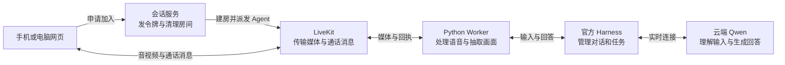

# LiveKitAgent 项目导航

LiveKitAgent 是一个在 Windows 电脑上运行、可从手机网页接入的视觉语音助手原型。用户说话并打开摄像头后，Qwen 可以根据语音和画面回答。当前开发和验证集中在**官方 Harness 模式**，它还支持持续讲解、分步教学和指定条件提醒。

## 先看这张图



图中是当前主线。**LiveKit 负责传输，Harness 负责安排何时回答、观察或提醒，Qwen 负责理解和生成。** 手机的本地 HTTPS 网关提供网页和信令入口。

[技术路线](docs/technical-route.md)介绍当前使用的技术栈、音视频与任务流程、模块分工和验证进展，可单独阅读。

## 一次普通视频问答

1. 网页取得麦克风权限，向会话服务申请加入。会话服务创建 LiveKit 房间，派发 Agent，并给网页房间令牌。
2. 网页和 Worker 加入房间。Worker 启动官方 Harness，等模型连接就绪后报告接通。网页随后发布麦克风，用户打开摄像头后再发布视频。
3. 例如用户对着杯子问「这是什么？」Worker 接收语音，并从视频里抽取较新的画面。Harness 把输入发给 Qwen，由 Qwen 理解并生成回答。
4. 回答经 Worker 和 LiveKit 数据通道送回网页。网页播放语音、显示文字，并回报播放状态。挂断时，会话服务和 Worker 清理房间及模型连接。

## 四种模式如何区分

模式在服务启动时选定，共用网页与 LiveKit。区别主要在谁控制回答，以及观察结果如何送达。

| 模式 | 它如何工作 |
| --- | --- |
| M2 直接问答（`legacy_auto`） | Qwen 自动判断一轮话什么时候说完，然后直接回答。 |
| 自研控制模式（`controlled_manual`） | Python 控制器先让模型判断下一步，再安排语音。适合明确步骤和连续物品介绍。 |
| 独立观察（`direct_background`） | 普通问答沿用 M2。实验性后台观察另走一条连接，只显示文字结果，另有手动管理的本地文本记忆。 |
| **官方 Harness（`qwen_live_official`）** | Node 中的官方核心负责实时对话和主动任务调度，本项目在其上实现持续讲解、教学和提醒。这是当前试测主线。 |

## 当前证据

- **已实现的能力**包括普通视觉问答、主体讲解与点选纠正、分步教学和条件提醒。
- 百炼官方模式默认启用通话内记忆。近期帧和较早的视觉摘要，与用户转写、任务状态和播放回执共用通话时间线。回忆可按时间、任务、事件或上轮范围检索。挂断时清空，可用 `QWEN_LIVE_MEMORY_ENABLED=false` 关闭。 [记忆设计与验证](docs/official-memory-design.md)
- 持续讲解中，点选用于纠正当前主体。确认后恢复普通的自动切换规则，原物品退到背景时也可以切到明确展示的新主体。
- 持续讲解和教学共用启动语音处理。明确的启动请求由任务播报首段内容，普通问答和同轮其他工具结果继续按对话处理。
- 用户明确说稍后或接下来展示时，讲解任务先准备连接和取帧，等局部画面变化后稳定约 250 毫秒再提交两帧。已在画面的物品可直接检查；无明显变化时约 4 秒做首次兜底检查，空结果后相同画面约每 6 秒检查一次。首个主体确认后进入普通讲解观察。
- 自动主体在同一组的两帧里都只剩小块边角时，清除旧主体并撤销待播讲解，随后重新搜索。
- 固定镜头或相同背景下也能快速换物。同一组两张新帧都能明确确认旧物离开，并显示位置稳定且突出的新物时，可直接切换。遮挡、证据不明确或新物不突出时仍需复核。
- 正式教学步骤由任务调度播报。明确的口头完成确认对应用户开口时的步骤，和视觉确认同时发生也只推进一次。当前步骤的追问继续由前台回答。
- 明显转镜头时开启最长 2 秒的 4 FPS 本地采样，距最后一次明显变化至少 250 毫秒后可恢复识别，每次模型观察仍使用两帧。自动主体与已讲内容在换景时清除，显式语音指定的主体继续沿用原规则。教学保持两次新画面确认，检测到局部变化并停稳后可将普通检查间隔从 4 秒缩至 2 秒。细微变化可能仍走普通检查，手机实测延迟和误判率待验收。
- **已有验证**覆盖离线回归和本地联调。本地联调用模拟模型验证了网页、LiveKit、Worker、官方核心及播放回执。早期百炼探针通过了部分固定视觉样例。
- **真实手机尚待验证**的部分包括当前版的响应时间、主体选择、自然语音多轮和插话体验。
- **百炼模型访问已由项目维护者确认恢复。** 先前的 `AccessDenied.Unpurchased` 是历史验证记录，当前版手机验收仍待执行。 [讲解验证记录](docs/guide-fast-response.md)

## 运行与排查入口

已有依赖和本地配置时，在项目根目录用 PowerShell 构建网页，再启动桌面通话。 [启动器](scripts/run_local.py)

```powershell
npm.cmd run build --prefix web
.\scripts\start-local.ps1
```

桌面默认地址是 `http://127.0.0.1:8000`，该启动脚本使用当前配置选择模式。手机官方模式用 `.\scripts\start-qwen-live-mobile.ps1`，启动后访问已准备好的手机 HTTPS 地址。新环境另需安装锁定的官方核心依赖 `npm.cmd ci --prefix harness/qwen-live --ignore-scripts`。通话服务可用 `Ctrl+C` 或 `.\scripts\stop-local.ps1` 停止。 [手机接入准备](docs/mobile-device-check.md)

手机体验页在同一个 HTTPS 地址后加 `/?view=call`，摄像头开启后可拖动 AI 小窗、轻点画面收起或恢复控件。持续讲解时，从右上角「更多功能」选择「选择主体」，再轻点一次要讲解的物品，随后轻点画面恢复为切换控件。首页 `/` 继续用于开发测试，显示详细步骤和错误。两页共用 [网页通话入口](web/src/main.js)。

**手机测试复盘。** 加入前勾选「记录本次测试」，通话中可按「标记问题」。挂断后，用电脑浏览器打开 `http://127.0.0.1:8000/mobile-test-report.html`（端口与 API 一致），根据手机显示的编号选记录。整场时间轴可切换「音视频」和「系统动作」，问答和问题标记在两种视图中共用时间位置。悬停预览，点击查看证据，放大后可拖动时间窗口。点图可打开实际交给 Harness 的 JPEG，视觉判断和记忆证据会引用对应帧。报告存放在 `.runtime/mobile-tests/<测试编号>/`，含画面、转写和记忆正文。可按目录移除旧测试，单次帧文件上限为 256 MiB，达到上限的缺图会在报告中提示。 [采集与留存入口](src/livekit_vlm_agent/mobile_test.py) · [复盘页面](web/src/mobile-test-report.js)

接不通时按链路查看网页状态、房间状态和 `.runtime/logs/worker.log`。代码从 [Worker 模式分派](src/livekit_vlm_agent/worker.py) 开始看，官方模式继续看 [Node 调度入口](harness/qwen-live/src/runtime.mjs)。

修改 Worker 或配置后，需要停止并重新启动服务，再开启新通话。排查记忆时，先确认该通话日志有 `official_ready` 的 `memory: call_visual`，再看 `official_memory` 是否产生记录、是否存在 `degraded`，最后看 `phase: query` 是否返回记录并 `submitted: true`。仅网页能接通不能证明新版记忆已经生效。手机网络切换后，还需核对手机配置中的媒体地址是否仍属于电脑当前网段。 [记忆测试方法](docs/official-memory-design.md#手机复测与排查)

启动器用 `.runtime/local-services.json` 记录自己和子服务的 PID 与进程创建时间。若上次异常退出，启动或停止时会清除已确认全部退出的旧记录。仍有子服务运行时，启动器会提示检查记录，由操作者确认怎样处理存活的进程。

## 接管时优先做什么

1. **固定当前试测版本。** 审阅已有改动，明确哪组代码和测试构成同一基线，方便以后复现或比较结果。
2. **用恢复访问后的百炼做一次手机验收。** 从普通看图问答开始，再试持续讲解、点选纠正和插话，最后挂断。用这条链路确定下一轮优先解决的体验问题。
