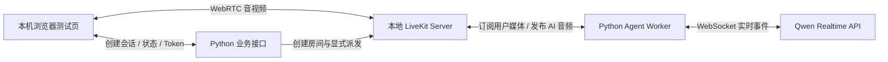

# LiveKit + Qwen 实时视觉通话 Demo 开发方案

日期：2026-10-29 更新。状态：M1纯语音闭环通过浏览器固定音频连续10轮验收；M2视频链路已实现，三个固定视觉样例与摄像头控制补测通过，手机真实通话及20个物品人工验收待完成。详见 `m2-verification.md`、`m1-verification.md` 和 `verification-report.md`。

## 1. 已确认的目标与范围

- Windows 本机开发与验证，LiveKit Server 本地自托管。
- 模型：`qwen3.8-omni-flash-realtime`，调用云端 API。用户已有 API Key；Workspace、地域、Endpoint 在接入时核对。
- 单房间、单用户、单 Agent；采集摄像头和麦克风，输出 AI 语音与回答文字。
- 支持多轮对话、用户插话、当前画面问答。
- 视觉由用户提问触发回答；本阶段不加入主动观察提醒、连续动作理解、数字人、RAG、长期记忆或业务工具调用。
- 端侧使用最小测试页面，为服务侧提供真实媒体输入和播放验证；不开发完整产品 App。

## 2. 推荐技术路线



推荐使用 Python 3.11、uv、LiveKit Agents / RTC / Server API SDK、异步 WebSocket 客户端、FastAPI；测试页采用 LiveKit JavaScript SDK 和 Vite，使用普通 JavaScript 即可。

LiveKit Server 使用官方 Windows 二进制。第一阶段不依赖 Docker、WSL、GPU 或数据库。采用模型 API 时，本机承担媒体处理和会话编排。

依赖的具体版本在 M0 验证时选择兼容组合并锁定；不直接依赖持续变化的 latest。Node.js 采用受支持的 LTS 版本，仅用于测试页开发。

推荐本地端口：LiveKit 信令 7880、Python API 8000、测试页 5173；实际媒体端口以 LiveKit 配置为准。M2因电脑无摄像头，已获用户授权扩展到鸿蒙测试手机：专用测试CA与HTTPS 8443、限定来源IP、媒体TCP 7881/UDP 7882，不开放公网访问。

## 3. 模块与职责

| 模块 | 主要职责 | 关键边界 |
| --- | --- | --- |
| 业务接口 | 创建随机房间、生成用户身份、签发房间限定 Token、显式派发指定 Agent、结束会话 | 模型 Key 和 LiveKit Secret 仅保存在服务侧 |
| Agent 入口 | 注册 worker、接受派发、绑定目标用户、创建与关闭模型连接 | 首版每个房间只接入一个目标用户 |
| Qwen 客户端 | 鉴权、配置确认、串行事件发送、接收与解析、超时、取消、错误分类 | 独立于 LiveKit，能单独做协议验证 |
| LiveKit 模型适配器 | 将 Qwen 音频、文本、发言事件与框架会话事件衔接 | 如实声明能力；未验证的历史裁剪、工具调用和恢复能力不启用 |
| 音频处理 | 输入格式转换、分块、输出 PCM 入轨、背压和取消 | 持续接收用户输入，避免播放时停止收音 |
| 视频处理 | 订阅摄像头、采样、JPEG 编码、限制尺寸、发送最新帧 | 仅处理目标用户摄像头，旧帧不无限排队 |
| 会话控制 | 关联 session / connection / response、管理打断和清理、丢弃过期事件 | 输入与输出状态分开记录，允许同时听和说 |
| 观测 | 事件日志、耗时、队列水位、丢帧、错误、模型用量 | 默认不保存原始音视频，不将 Base64 媒体写入日志 |
| 测试页 | 加入 / 挂断、设备开关、画面预览、AI 播放、回答文字和错误展示 | 只承担服务侧验证需要的交互 |

### 适配策略

先建立独立的 Qwen WebSocket 客户端，再通过 LiveKit Agents 的自定义实时模型接口接入 AgentSession。M0 必须检查所锁定 SDK 的抽象接口、视频路径和打断语义，不能直接将其他厂商适配器改一个地址后视为兼容。

若 AgentSession 无法在所选版本中正确表达 Qwen 的关键行为，保留同一个 Qwen 客户端，用 LiveKit RTC 原始媒体轨道完成薄桥接。届时在设计记录中说明哪些状态和指标需要自行管理，避免同时维护两套完整会话实现。

## 4. 关键实现决策

### 4.1 模型连接与音频

- 首先核对地域、Workspace、Endpoint、模型权限和 Key；只有 API Key 不代表其余配置已经确认。
- 等待 `session.created`，发送配置并等待 `session.updated` 后，再发送媒体。
- 以官方当前配置示例中的 16 kHz、16-bit、单声道 PCM 输入和 24 kHz PCM 输出为初始验证组合；按实际接口支持范围配置。
- 使用有状态的音频重采样与正确的 PCM 帧边界；先以约 20–40 ms 输入分块实验，记录吞吐和延迟后调整。
- 音频持续发送与模型接收独立运行。WebSocket 写入通过单一发送器有序调度，不能让图片编码或大量图片排队阻塞音频。
- 第一版不增加独立 STT/TTS。AI 回答文字采用模型输出转写；用户语音转写作为可选能力另行验证。

### 4.2 视频采样与时序

- 初始 1 FPS、JPEG、约 640×360 或 640×480，尺寸与帧率可配置；是否满足模型图像限制在 M0 核实。
- 用最新帧缓存替换历史待处理帧；先抽样再编码，避免每一帧都做 JPEG 编码。
- 记录采集、编码完成、发送时间；设置最大帧龄并统计过期帧。
- 遵循 Qwen 的发送约束：至少发送过一次音频后再发图片；自动轮次模式下，相关画面应在本轮结束前送达。
- 不假定在收到远端语音结束事件后补一帧还能影响当前回答。用“更换物品后立即提问”验证视觉时效，必要时再调整采样和轮次提交方式。
- 用户不说话时不主动生成回答；持续采样和响应触发是独立策略。

### 4.3 轮次与打断

- 协议冒烟先用手动提交固定音频建立可重复基线；实际通话优先验证模型侧语义轮次。M0 对照发现 semantic_vad 的短句丢失与 semantic_vad_ec 的分句更积极行为；当前候选配置为 semantic_vad_ec，保留切换并在 M3 调校，见验证报告。
- 第一版由模型侧负责主要轮次判定与回答触发；本地 VAD 如用于测量，不再重复触发回答。
- 分别验证“嗯”等附和、短暂停顿、明确插话，确认模型和框架对同时说话的行为一致。
- 对需要中断的回答：取消远端生成、清空服务端输出缓冲、停止尚可停止的播放、屏蔽在途旧片段；浏览器已进入播放链路的尾音需实测。
- 对取消后的片段使用 response ID 和连接代次识别；连接重建后不接受上一个连接的音频。
- 验证取消与历史记忆的关系；不默认支持精确删除未播出的内容，也不默认模型已经知道用户听到了哪里。
- 首版先戴耳机测试，随后单独测试浏览器回声消除和外放场景。

### 4.4 生命周期与错误

- 每个房间独立管理模型会话和媒体任务；用户离房、挂断或 worker 退出均应释放资源。
- 鉴权和参数错误直接给出可定位信息，避免自动重试；临时网络错误采用有次数上限的退避。
- 首版断线恢复采取“新建模型会话并明确提示上下文已重置”。不承诺无缝恢复，不重放已提交的旧音频。
- 以服务端 TTL 清理遗留房间；显式结束会话时关闭模型连接并清理房间。关闭页面事件只作尽力通知。
- 对输出队列设水位和最大积压时长；异常积压应取消本轮并提示，避免不断累加延迟。

## 5. 开发里程碑与交付物

工作量为范围估算，不是交付承诺；按单人串行实施、模型权限与网络可用估算，总计约 7–12 个工作日。M0 完成后按适配复杂度更新。

| 里程碑 | 工作量参考 | 内容 | 可验收交付物 / 进入下一步的条件 |
| --- | --- | --- | --- |
| M0 环境与协议验证 | 1–2 天 | 准备 Windows 环境；核对模型配置；固定音频单轮与多轮；加图片；验证轮次和取消；检查 SDK 扩展接口 | 可复现冒烟脚本、脱敏事件样本、能力矩阵、依赖锁；确认主适配路径 |
| M1 LiveKit 纯语音闭环 | 1–2 天 | 本地 Server；业务接口；worker 派发；测试页；PCM 上下行 | 浏览器加入后自动接通 Agent，连续完成 10 轮纯语音对话 |
| M2 视频问答 | 1–2 天 | 摄像头订阅、采样编码、图片发送、帧龄日志、回答文字 | 能回答物品与场景问题；能验证更换画面后回答是否更新 |
| M3 对话控制 | 2–3 天 | 语义轮次、取消、输出清理、旧响应隔离、附和与回声测试 | 一组可复现打断场景，无旧音频在下一轮重新播出 |
| M4 稳定性与交付 | 2–3 天 | 资源清理、断线处理、错误提示、耗时统计、必要自动测试、README | 完成稳定性验收，提交性能基线、限制说明和 Windows 启动步骤 |

M0 如遇模型权限或 Endpoint 问题，可独立继续安装 LiveKit、验证房间与媒体轨道；真实模型集成仍以接入成功为前提，不用模拟结果替代验收。

## 6. 验收场景与指标

### 功能与稳定性

| 场景 | 首版验收口径 |
| --- | --- |
| 纯语音 | 至少 30 轮累计测试，支持连续追问 |
| 当前画面理解 | 固定 20 个光线正常、物体清晰的样例，人工评分目标至少 18 个正确；这是项目目标，需模型基线校准 |
| 画面切换 | 杯子→手机等切换后立即提问，检查模型是否基于最新可用画面；报告失败样例和对应帧龄 |
| 打断 | 至少 10 次明确插话，旧响应无跨轮污染；另测附和和句中停顿 |
| 状态变化 | 关闭摄像头仍可语音对话，重新开启后恢复图像输入 |
| 断线 / 异常 | 测试错误 Key、短暂断网、模型错误和用户离房；错误可解释，任务与连接可清理 |
| 稳定通话 | 连续 20 分钟，队列不持续增长；挂断后连接和任务释放 |
| 重复使用 | 连续加入 / 挂断 10 次，无重复派发或遗留音频 |

### 性能目标：先测基线，再确认硬性要求

- 用户说完到实际听到首段回答：初步争取 P50 ≤ 2 秒、P95 ≤ 4 秒。
- 系统确认需要中断后到旧音频停止：初步争取 P95 ≤ 500 ms；另外记录用户开始插话到识别中断的耗时。
- 视频采用 1 FPS 时，最新已发送帧的帧龄初步争取 P95 ≤ 1.5 秒；该指标不代表模型一定采用了这帧。
- 所有目标均基于本机、正常网络、无额外业务工具调用、耳机通话；模型侧和端侧影响需要分别报告。
- M4 至少报告 30 轮样本的分位数；样本规模有限，不用于推断生产 SLA。
- 服务端耗时采用单调时钟；跨浏览器与服务端不能直接相减不同来源的时间戳。浏览器播放时刻需通过本地播放观测或人工录测估计，并注明测量误差。

### 必要的自动化验证

- 通过脱敏事件回放验证响应完成、取消后迟到音频、重连旧事件及错误处理。
- 验证视频队列在拥塞时保留新帧，音频不被图像处理饿死。
- 验证房间限定 Token、会话隔离与离房清理。
- 真正的语音自然度、视觉正确率和回声体验使用真实模型人工验收；模拟测试不代替效果测试。

## 7. 建议工程结构

以下为完整开发阶段的建议结构；当前已创建配置、依赖锁、准备脚本和初步验证记录，业务模块后续补齐。

```text
LiveKitAgent/
  pyproject.toml
  uv.lock
  .env.example
  src/livekit_vlm_agent/
    config.py
    api.py
    worker.py
    session.py
    providers/qwen_client.py
    providers/qwen_realtime.py
    media/audio.py
    media/video.py
    telemetry.py
  web/                   # 最小测试页
  scripts/               # 协议冒烟、Windows 启动辅助
  tests/                 # 有价值的协议与生命周期回归验证
  docs/
    development-plan.md
    protocol-findings.md
    verification-report.md
  README.md
```

配置至少包含 `LIVEKIT_URL`、`LIVEKIT_API_KEY`、`LIVEKIT_API_SECRET`、`QWEN_API_KEY`、`QWEN_WORKSPACE_ID`、`QWEN_REGION`、`QWEN_REALTIME_URL`、`QWEN_MODEL`、音色、采样帧率及日志级别。密钥通过本地环境变量或未提交的环境文件提供，不放在浏览器中。

## 8. 资源与启动前检查

- 已具备：Windows 开发机、项目工作区、用户确认可用的 API Key。
- 已核对：北京地域、Workspace ID、工作空间专属 Endpoint、本地 Key；真实连接与 Tina/PCM/semantic_vad 配置确认通过。模型额度、并发与实际效果待继续验证。
- 已准备：项目内 Python 3.11.18、uv 0.13.6、LiveKit Server 1.13.11，复用 Node.js 24.22.0；依赖已锁定。本机 RTC 合成音频验证通过。LiveKit CLI 暂不需要；耳机和摄像头在真实通话阶段核对。
- 费用来源：Qwen 音频 / 图片 / 文本输入输出。用真实测试用量估算每分钟成本；需要查询单价时以控制台为准。前期无需购买 GPU。
- 不默认录制原始音视频；效果复现时可选择单独保存经确认的测试样例和脱敏事件。

## 9. 决策记录

用户已确认：Windows 本机、本地自托管 LiveKit、无数字人、用户提问时结合画面回答。

技术方案建议：Python + 异步 WebSocket、独立 Qwen 客户端、自定义 LiveKit 实时模型适配、最小浏览器测试页；在 M0 用真实协议验证后锁定。

性能数字和 7–12 天工作量目前是建议目标，尚未作为硬性承诺。音色可先用账号实际支持的默认值。暂不需要用户为这些常规实现细节追加确认。

2026-10-28 进度：用户已要求开始资源准备和配置，并允许少量真实协议验证。本地环境、配置和依赖锁已完成；房间 API、真实本机 RTC 音频及 Qwen 连接/配置探测通过。下一步继续 M0 的固定语音/图片、多轮、轮次与取消验证；当前尚未完成 M0，也尚未实现通话业务。

2026-10-29 进度：已执行 M0 真实音频、同连接记忆、公开照片/画面切换、显式取消、语义插话与附和/停顿对照；7项离线回归通过，依赖锁继续适用。优先采用独立 Qwen 客户端加自定义实时模型适配的主路线，下一步 M1。已知短句/多句轮次差异和未验证的精确历史裁剪、浏览器播放中断等边界均保留在验证报告中，未标记为全部通过。

2026-10-29 M1进度：已实现会话API、房间限定Token、显式派发、Worker、AgentSession自定义实时模型适配与浏览器纯语音页面。同房间连续10轮自动验收及19项Python回归通过，另验证权限拒绝/取消加入/窄屏布局，挂断后核对遗留房间与活动任务。提供统一启动/停止脚本；原始设备音视频不录制。具体结果和真人/声学/稳定性边界见 `m1-verification.md`，下一步M2。

2026-10-29 M2进度：已实现目标摄像头订阅、最新帧采样/JPEG异步编码、图片发送与帧龄观测；页面支持摄像头开关和前后镜头切换。31项Python回归通过，真实Qwen完成狗/红色/换蓝色三个视觉场景，控制补测通过，挂断后房间/任务/活动会话为0。手机前置检测由用户确认通过，正式手机媒体通话及20个真实物品人工验收待完成；早期云端错误和逐字复述差异保留在 `m2-verification.md`，没有标记M2全部通过。

## 10. 官方参考

- Qwen 模型、Endpoint、事件、音视频与取消规则：https://www.alibabacloud.com/help/en/model-studio/realtime
- LiveKit 本地运行（含 Windows）：https://docs.livekit.io/transport/self-hosting/local/
- LiveKit Realtime 模型：https://docs.livekit.io/agents/models/realtime/
- LiveKit Python 实时模型接口：https://docs.livekit.io/reference/python/livekit/agents/llm/
- LiveKit 视频接入：https://docs.livekit.io/agents/multimodality/vision/video/
- LiveKit Python 起步工程：https://github.com/livekit-examples/agent-starter-python

以上是 2026-10-28 查阅到的接口资料。实现前应对照所锁定 SDK 与实际模型权限重新核实关键能力。
