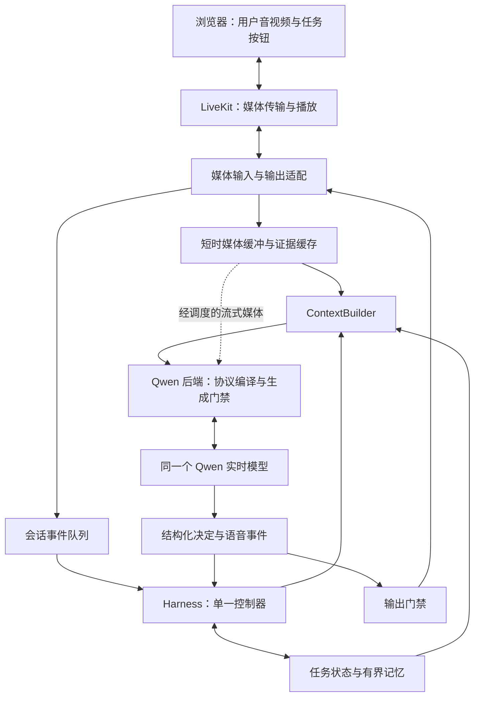

# 实时多模态模型 + Harness 构建方案

2026-11-02 路线调整：下一阶段以 [M2 直接对话 + 独立后台观察与记忆](m2-background-observation-memory-plan.md) 为主线。本文保留旧 H0–H5 的设计与实施历史；其中取消、证据和播放约束继续可复用，不再要求按原 H3/H4/H5 顺序推进，也不据此宣布旧阶段验收完成。

日期：2026-10-30（北京时间）。状态：开发交接方案；本文不代表功能已经实现或协议已经验证。

实施进展（2026-10-30）：H1 离线骨架已实现，H0 已做四次固定样本生成，P3 语音切换仍失败，尚未接入正式通话。详细通过/失败/待验证项见 [H0/H1 验证记录](harness-h1-verification.md)。下文保留原始计划与验收标准。

H2 更新（2026-10-30）：受控通话已接入手机原入口，保持首次音频模态及固定工具声明，用应用门禁隔离 DECIDE/SPEAK；指导只按用户确认推进。真实测试、失败保留及手机操作见 [H2 验证记录](harness-h2-verification.md)。H3/H4/H5 仍按下文标准单独验收。

2026-11-02 用户确认的优先验证方向：先实现 `showcase` 连续物品介绍原型，区别于预先规划有限提纲的 narration。用户一次请求后，由稳定候选画面触发安静观察，两次确认后简短讲解，等待实际播放完成再考虑下一件。普通指导仍按用户确认推进；H3 原始有限提纲和 H4/H5 的完整验收未据此宣布完成。见 [原型验证记录](harness-showcase-verification.md)。

## 1. 目标与已确定的路线

在现有 LiveKit + Qwen 实时视觉通话上，增加一层应用侧 harness，使系统从“用户问一句、模型答一句”扩展到：

- **视觉问答**：结合当前画面回答，支持追问、纠正和必要的历史引用。
- **持续讲解**：用户提出一次目标后，模型分段讲解；每段播放结束后可以主动继续，直到讲完、暂停或被打断。
- **操作指导**：模型拆分步骤，讲解当前一步；等待用户操作，结合新画面或用户确认检查，再决定下一步。

采用**一个 Qwen 实时多模态模型 + harness**。同一个模型承担理解目标、规划、视觉判断和语音讲解；harness 是普通程序，负责状态、上下文、调度、校验和生命周期。第一版不增加第二个规划模型、独立生成式视觉模型或独立 STT/TTS 链路。

一个任务可以有多次模型生成，但不意味着要部署多个模型。默认一个用户、一个 LiveKit 会话、一个活动 Qwen 连接、一个当前任务，模型请求串行执行。

### 1.1 范围与交付边界

先验证有限步骤的日常物品操作和有限主题的画面讲解。目标是能持续推进任务，不是永不停顿地输出语音。

第一版暂不引入长期用户记忆、向量数据库、多 Agent、通用业务工具、远程 MCP、联网搜索、跨连接无感恢复。内部控制用 Function Calling 属于本方案范围，与操作外部业务系统的工具不同。

本文只安排后续开发，不启动服务、不发送音视频、不进行付费模型验证。开发对话应先阅读本方案及项目现有验证记录，再按阶段实施。

## 2. 当前项目基线及与旧方案的关系

### 2.1 已有实现

| 位置 | 当前行为 | 本方案中的处理 |
| --- | --- | --- |
| `worker.py` | 创建 AgentSession，使用实时模型侧轮次检测，装配 CameraInput | 增加 harness 装配、事件接入和关闭流程 |
| `providers/qwen_client.py` | WebSocket 连接、有序写入、音频输出门禁、配置/取消 | 保留底层协议客户端，增加经验证的工具事件与控制能力 |
| `providers/qwen_realtime.py` | 音频和最新帧直接写入；模型自动回答；本地记录返回文字 | 增加受控生成、控制结果通道、上下文编译和任务关联 |
| `media/camera.py`、`media/video.py` | 摄像头生命周期、最新帧替换、JPEG 编码、帧龄限制 | 复用并补充 frame_id、历史关键帧和检查证据关联 |
| `web/src/main.js` | 通话、设备开关、语音和文字输出、状态 | 增加简洁任务状态、暂停/继续/结束；开发阶段支持明确提交 |

当前 `generate_reply()` 已有发送 `response.create` 的入口，但不支持任意逐轮 instructions，也不代表完整手动编排已接通。适配器目前拒绝工具配置，并未实现有效函数调用流；不能只修改能力声明就视为支持。

当前默认短回答和 `max_tokens=256` 面向问答。后续按“决策、讲解、问答”分别配置输出预算，验证不会截断工具参数；不能通过无限加长单次回答替代任务循环。

既有视觉验证覆盖狗、红色画面、切换蓝色等固定场景；手机正式媒体通话及广泛真实物品验收仍有待完成项。参见 [M2 验证](m2-verification.md)。

### 2.2 与已有 harness 上下文设计的关系

[harness-context-design.md](harness-context-design.md) 保留为多轮问答、证据选择与上下文控制的细化设计。本文扩展任务状态、主动生成、持续讲解和操作指导。

路线调整如下：旧文先验证 `staged`；本次讨论将 **`streaming_gated` 作为最终交互目标**，开发仍先使用明确提交和受控媒体批次建立可重复基线，再接入流式输入和自动端点检测。不能把阶段性的按键提交验收当作最终实时交互完成。

旧开发计划中“本阶段不主动观察、不规划任务”的范围仅描述原 M1/M2；本文定义新增阶段，不追溯修改既有验收结论。若文件冲突，本次任务编排以本文为准，旧文证据来源、历史边界和取消原则继续适用。

## 3. 总体架构与职责



| 参与者 | 应承担的职责 | 不能替代的职责 |
| --- | --- | --- |
| Qwen | 理解原始需求；提出计划；结合画面检查；生成面向用户的语音 | 程序计时、可靠持久状态、实际播放控制 |
| Harness | 安排调用；构建上下文；校验决定；记录进度；等待、取消和限额 | 不用固定规则假装已经理解画面或证明动作完成 |
| LiveKit / RoomIO | 采集、传输、收音和播音；提供可获得的媒体/播放事件 | 任务规划和语义完成判断 |
| Qwen 后端适配 | 把应用意图编译为协议，归一化事件，管理回执和输出 | 不在底层 WebSocket 回调中直接推进业务步骤 |

最终交互中，输入可以持续采集，上传可以流式进行；模型并非在每一帧上传时都自动运行任务判断。**上传、提交、生成、播放是四个不同阶段。**

## 4. 三种模式及完整示例

### 4.1 视觉问答 `qa`

用户说话 → 明确轮次边界 → harness 构造当前状态和相关证据 → Qwen 回答 → 等待下一次用户输入。

无任务时不因摄像头开启或定时器到达而主动讲话。

### 4.2 持续讲解 `narration`

用户：“给我讲讲这个路由器各个接口的用途。”

1. Qwen 结合需求和画面提出有限讲解提纲，先选择一小段。
2. harness 保存任务与当前段，触发 Qwen 生成语音。
3. 等实际可观测的播放完成，再更新“已播完的段”，安排下一段决策。
4. Qwen 根据提纲、已讲内容和最新有效画面继续；避免每段都重新开场或重复介绍。
5. 达到用户要求的范围后结束，不靠无休止重复来满足“持续”。

讲解若只依赖已确认主题和历史资料，可以在没有新画面时继续；若要描述“当前镜头中的接口”，必须有有效当前证据。镜头换物时重新判断话题关联，不能默认仍是原设备。

### 4.3 操作指导 `guidance`

用户：“教我安装这个路由器。”

| 时点 | Qwen | Harness |
| --- | --- | --- |
| 接收目标 | 理解目标，提出简短计划和第一步 | 创建任务，保存计划草案和版本 |
| 给出第一步 | 语音讲解连接电源 | 记录本段对应步骤，跟踪播放 |
| 播放结束 | 暂不输出 | 进入等待，开始安排观察检查 |
| 用户操作 | 在检查被触发时分析新画面 | 持续采集；按节流策略选帧并发起检查 |
| 检查结果 | 返回完成、未完成或无法确认，并引用证据 | 校验结果；接受后再推进或等待 |
| 用户插话 | 理解“是这个接口吗”等问题 | 先停止旧输出，暂停计时器，保留步骤 |
| 恢复 | 回答新问题，决定是否调整当前步骤 | 执行新决定，重新建立等待/讲解节奏 |
| 结束 | 总结任务结果或说明未完成部分 | 停止主动调度，保留普通问答能力 |

“指示灯亮”只证明模型在特定画面中的观察，不自动证明路由器安装全部完成。完成条件必须对应具体步骤。

## 5. 状态模型：任务状态与输入输出状态分开

### 5.1 任务状态

| 状态 | 含义 | 主要后续动作 |
| --- | --- | --- |
| `idle` | 无活动任务 | 等待需求 |
| `planning` | 正在确定目标、模式或步骤 | 接受计划、澄清、取消 |
| `active` | 任务可继续推进 | 生成下一段或当前步骤讲解 |
| `waiting_action` | 等待用户操作 | 等待检查时机或用户发言 |
| `checking` | 正在判断当前步骤 | 完成、未完成、无法确认 |
| `paused` | 用户暂停、播放状态不明或其他阻塞 | 用户恢复或结束 |
| `completed` | 有限任务已完成 | 结束主动调度 |
| `cancelled` | 用户结束任务 | 结束主动调度 |
| `failed` | 不可继续的连接/协议错误 | 说明失败，按既有策略结束或重建 |

另设 `input_state = quiet / user_speaking / turn_pending`；`output_state = idle / generating / playing / draining / cancelling`。生成和播放可以重叠，所以还需独立布尔/标识字段，而非仅靠一个枚举判断全部行为。

必须区分：模型生成结束、LiveKit 服务端队列播完、浏览器实际播放、用户确认已理解。这些不是同一个事实。

### 5.2 必须持有的标识和字段

```yaml
SessionState:
  session_id: s1
  connection_epoch: 1
  state_revision: 12
  generation_epoch: 4
  task:
    task_id: task1
    task_revision: 3
    mode: guidance
    status: waiting_action
    goal: 安装当前路由器
    plan: []                    # 有界、可修订，不预设永不变化
    current_step_id: step1
    completion_condition: 电源接口已接好且指示灯亮起
    completion_basis: null      # visual / user_reported / mixed
    resume_point: null
  input:
    state: quiet
    pending_turn_id: null
  output:
    response_id: null
    segment_id: null
    generation_active: false
    playback_active: false
    playback_status: completed  # 或 interrupted / unknown
  camera:
    enabled: true
    camera_epoch: 2
    latest_frame_id: f103
  pending_observation: null
  pending_decision: null
```

本地时间采用服务器单调时钟。只有关键业务变化递增相关 revision；每到一帧不应令所有决策失效。切换镜头、用户插话、任务变更和连接重建必须使相关旧操作失效。

## 6. 模型与 harness 的控制契约

### 6.1 推荐两阶段：先决定，再发声

第一版把模型输出区分为两种调用用途，仍使用同一个模型和连接：

- **DECIDE**：理解需求、规划或检查，返回结构化控制决定；不将控制过程播给用户。
- **SPEAK**：基于已接受的决定生成自然语音；这一步不允许隐式修改任务进度。

这样，“检查后发现未完成”可以安静地回到等待，不必每次都说话。代价是需要说话时可能多一次串行生成，首音和切段间隙必须测量。稳定后再研究合并，不能一开始假设同一次 Response 必定同时包含完整语音和可执行工具决定。

### 6.2 最小内部工具 `submit_task_decision`

优先暴露一个有版本的内部函数，减少多个工具之间的状态冲突。示例是应用契约，不是 Qwen 原生字段：

```json
{
  "schema_version": 1,
  "action": "wait",
  "mode": "guidance",
  "plan": null,
  "current_step_id": "step1",
  "step_instruction": "把电源线接到电源接口",
  "completion_condition": "电源线接好，指示灯亮起",
  "assessment": {
    "result": "incomplete",
    "basis": "visual",
    "evidence_ids": ["f103"],
    "reason": "当前画面中电源接口仍为空"
  },
  "speech_intent": null,
  "next_check_after_ms": 5000
}
```

建议动作：`start_task / explain / wait / advance / clarify / pause / complete / cancel / answer`。按动作建立不同必填字段和语义约束；实现时用 Pydantic 判别联合或等效校验，拒绝任意状态补丁。计划只在创建或明确修订时提交，避免每次复制不断膨胀。

`speech_intent` 表达要告诉用户什么，不作为固定脚本文字强制逐字朗读。harness 根据接受的决定配置 SPEAK，模型自行生成自然语音。

`task_id`、revision、context_id 和 generation_epoch 由程序绑定调用，不信任模型回传这些标识；模型的 evidence_id 必须能在本次上下文中找到。模型不能自行声称看到了未提供的新帧。

### 6.3 校验与执行规则

1. 校验工具名、完整参数、类型、枚举、长度、动作和当前状态是否匹配。
2. 检查调用所属 connection / generation / task 版本仍有效；过期决定不产生状态变化。
3. 检查完成判断是否有本次可用证据。用户口头确认允许作为 `user_reported`，不能改写为视觉确认。
4. 状态更新必须原子、幂等；按 `(connection_epoch, call_id)` 去重。重复回调不能重复推进一步。
5. 工具参数增量到达时只组装，不执行；仅在完整工具项及所属 Response 的成功终态确认后接受。截断、取消、失败均不接受部分决定。
6. 工具结果回填包含 `accepted / reason / authoritative_state`，让模型知道实际状态。拒绝原因应简短、可修正。
7. 文本声称“已经进入下一步”但没有有效控制决定时，不推进状态。
8. 不能保证模型一定调用工具。无工具、坏参数或矛盾决定最多进行一次有界纠正；仍失败则暂停或澄清，不无限重试。
9. 若同一 Response 返回多个决定，按收到的完整项逐项校验版本与兼容性；冲突时不依次执行造成跳步，转为一次纠正或暂停。不能假定远端支持关闭并行工具调用。

### 6.4 决策、工具回执和发声的时序

```text
冻结 ContextEnvelope 与允许的动作
→ 配置 DECIDE，等待配置确认
→ 提交本次新增输入（如有），请求生成
→ 收集工具参数，等待 Response 成功结束
→ 校验并接受决定，回填真实工具执行结果
→ 根据决定：
    无需讲话：不立即续答，进入等待/完成
    需要讲话：配置 SPEAK，禁用控制工具，再显式生成语音
→ 等待对应播放完成
→ 记录本段播放状态，执行决定所关联的后续调度
```

“回填工具结果后暂不立即续答、稍后带新观察继续”及切换工具/输出模态的行为必须在 H0 验证。若供应商要求立即完成工具轮次，可增加一次仅文本的短确认并在输出门禁拦住，再进入等待；不能让一个未闭合工具轮次被新的用户输入随意覆盖。

DECIDE 中意外返回语音也不能播出；SPEAK 中出现工具决定不直接执行。控制 JSON、检查理由和内部状态不得出现在用户字幕里。

## 7. 上下文构造与记忆管理

### 7.1 每次生成前构造不可变快照

延续旧文 TurnContext，但用 `ContextEnvelope` 覆盖用户提问、定时观察和主动续讲：

```yaml
ContextEnvelope:
  context_id: ctx42
  purpose: observe             # user_turn / plan / observe / narrate / speak
  trigger: observation_timer
  session_id: s1
  connection_epoch: 1
  task_id: task1
  task_revision: 3
  state_revision: 12
  generation_epoch: 4
  policy_version: guidance-v1
  task_snapshot: {}
  input:
    turn_id: null
    audio_ref: null
    transcript: null           # 不依赖回答结束后才有的转写
    audio_origin: live_mic
  evidence:
    - frame_id: f103
      role: current_view
      camera_epoch: 2
      received_mono: 12345.6
      age_ms_at_build: 230
      media_ref: memory://f103
  history:
    recent_turns: []
    played_segments: []
    interrupted_segments: []
    confirmed_facts: []
    model_observations: []
    unresolved_references: []
  response_policy:
    allowed_actions: [wait, advance, clarify]
    speech_allowed: false
    missing_evidence: clarify_or_wait
  budgets: {}
```

引用和标识是本地协议，必须由后端编译成远端实际支持的输入；发送了 frame_id 文本不代表云端自动建立了该 ID 与图片的绑定。

### 7.2 两条输入通道

**媒体通道**负责音频、采样帧和短时缓冲；**控制通道**负责规则、任务、近期上下文和本次目的。harness 统筹两者，不要求先将所有媒体转写，也不要求先理解每一帧。

`streaming_gated` 允许提前上传，但生成前必须完成本次媒体的协议提交、状态更新和版本检查。构造或决策期间的新帧进入后续缓存，不无边界混入当前证据。必要时短暂停止云端上传，保持本地采集，先保证可解释的证据边界。

提前进入云端的历史不能靠 ContextBuilder 撤回。本方案第一版保证“新增输入经过调度、生成经过门禁”，不承诺“模型只看得到 ContextEnvelope”。

### 7.3 有界记忆

- 当前目标、当前步骤、必要计划和完成记录作为可检查任务状态保存。
- 保存少量最近轮次、关键帧、用户纠正和历史引用；按用途选择，不一律堆入全部历史。
- 区分 `user_reported`、`model_observation`、程序直接观测事实；模型猜测不写成已证实事实。
- 区分生成文字、已转发字幕、播放完成片段和被打断片段；未完整播出的指令不能当成用户已经听过。
- 旧图只用于明确历史问题；摄像头关闭、切换或帧过期时，不以历史图冒充当前图。
- 默认只保留会话内存；音视频、Base64 和完整用户内容不默认写日志。挂断释放。

不要求暴露或保存模型内部思维过程；只保留任务计划、简短决策依据及可验证来源。

### 7.4 上下文编译及远端历史边界

固定行为规则与不可信画面文字、用户引用、模型观察分开。动态状态放在明确数据区域，每次整体重建并限长，不能不断向 instructions 追加。

当前可用 `session.update` 更新 instructions；它是会话级配置，不能当作任意历史消息编辑接口。优先探索经验证的结构化数据通道；若暂用 instructions 承载状态，必须测试模型遵循与数据边界。

不要照搬其他厂商的任意 `conversation.item.create` 消息、多图输入或 history truncate。历史多图若不能可靠关联，第一版对比较问题澄清，不改用未经验证的模型“记忆”。

长会话接近本地或远端预算时，在无活动生成/播放的位置暂停主动任务；未经验证不得自动裁剪远端历史或重建后静默恢复。第一版可提示重新加入，保留问题记录；后续再验证连接重建与上下文恢复。

## 8. 轮次检测与生成权

### 8.1 只能有一个生成控制者

最终 harness 模式由控制器独占 `response.create`。不能一边保留云端 VAD 自动生成，一边让观察定时器另行请求回答。

现有自动问答路径作为 `legacy_auto` 保留，用于对照和回退；不得在同一模型连接里与 harness 控制器同时运行。

### 8.2 实施路径

1. **基线**：手动提交/按住说话，关闭云端自动轮次，验证受控输入、工具调用和主动续讲。
2. **自动交互**：接入本地或框架可用的声学 VAD/端点检测，检测用户开始和结束说话，再由 harness 提交和生成。声学检测组件不等于新增一个规划大模型。
3. **优化候选**：只有当前模型实际支持“保留服务端检测、关闭自动生成”，且实测通过，才复用服务端检测。不能凭其他 API 的 `create_response=false` 等字段假定兼容。

关闭云端 VAD 后不能继续只依赖云端 speech_started/stopped。需验证 LiveKit 锁定版本中的事件映射、预卷音频、短句、停顿、附和和回声。短暂停顿不直接当作任务结束。

选择具体本地检测器之前检查已有依赖和安装代价；无需为本方案先升级整套 SDK。

### 8.3 调度优先级

`挂断/明确停止 > 用户开始说话 > 用户轮次提交 > 当前有效播放处理 > 主动续讲 > 观察定时器`。

用户开始说话立即取消待执行的观察；已进行的安静检查也要失效。并发事件进入一个串行控制队列，不能在多个回调中直接各自调用生成。

## 9. 用户沉默时，如何检查画面

### 9.1 观察调度

仅在 `guidance + waiting_action` 等需要视觉检查的状态启动。检查来源可以是定时器、用户“好了”、界面确认或后续加入的画面变化信号。

第一版：间隔检查 + 用户主动确认。画面变化检测后续再加，它只决定“值得看一眼”，不判定动作成功。

一次检查流程：

```text
检查任务仍在等待，且用户没在说话、没有活动生成/播放
→ 合并重复检查请求，取最新有效帧
→ 验证帧龄、镜头代次、当前步骤和调用预算
→ 构造 observe 上下文
→ 按已验证协议提交最新观察输入
→ DECIDE：输出 complete / incomplete / unknown 的结构化判断
→ 校验和接受后推进一步、继续等待或澄清
```

这里的 complete 表示本步骤完成判断，不等于整个任务 completed。未完成且没有新提示必要时安静等待，不每隔几秒说“还没好吗”。

### 9.2 最关键的协议验证：新图如何进入本次判断

当前链路中，图片与音频的输入、提交有关联。因此不能简单“append 新图 → response.create”，就宣称模型读取了当前帧。

H0 必须对比明显不同的 A/B 画面，验证：用户不再发言后，如何使 B 图在新一次检查中可用，以及哪些旧音频/图片会一起提交。候选是提交真实麦克风的有界静默片段并带当前帧；若改用合成静默，必须标为 transport_silence、验证协议接受与上下文影响，不能伪造成用户说话，也不能重播用户旧问题。

仅收到发送或提交回执不等于理解了 B 图。需要实际模型输出与图像变化对照。

若图像主动检查路径不可用，阶段性交付“用户确认后继续”并如实标记视觉自动检查未完成；不能默认引入第二个模型绕过，也不能把旧帧判断当作成功。

### 9.3 证据与不确定性

每次检查绑定具体帧和服务端接收时间；发送前再检查一次新鲜度。模型返回的观察依据必须来自本次已发送、可关联的证据。

看不见接口、指示灯被遮挡、视角不能判断时返回 unknown；适当请求调整镜头或口头确认。模型自报置信度不能单独作为进入下一步的阈值。

普通步骤可以接受清晰的单次观察或用户确认；对于容易误判的完成条件，测试后再配置连续观察一致性，不机械要求每步两次检查而增加延迟。

## 10. 持续讲解、播放与打断

### 10.1 讲解分段

按有限提纲逐段生成，段长可配置。每段只涵盖少量新内容，保存当前段和已播进度；不一次性预生成全部语音，也不每段重复读取完整历史。

下一段最早在当前段播放完成且用户未发言时触发；第一版不预取下一段，减少失效和重复。后续仅在指标证明需要时做预取。

`response.done` 只结束云端生成。优先验证锁定 LiveKit 中 speech handle / playout 相关事件；服务端队列排空也不能宣称用户已实际听清。开发记录应标明 `server_playout` 或 `client_ack` 的测量口径。

若无法可靠关联播放结束，主动续讲进入暂停/等待明确继续，不用固定 sleep 猜测一段已经播完。

### 10.2 插话处理

1. 用户开始说话：撤销定时检查和续讲，增加 generation_epoch，先关闭本地旧输出门禁。
2. 取消仍在生成的远端响应；清理可清理的播放缓冲，停止旧语音继续进入轨道。
3. 将旧段标记 interrupted，播放进度不明则记录 unknown，不把整段归为已讲完。
4. 等用户轮次完成，携带原任务与中断位置重新调用 Qwen。
5. 模型判断是追问、暂停、改目标还是取消；harness 接受决定后恢复相应流程。

音频仍持续采集；取消后旧音频、旧工具决定、旧检查结果一律按连接和生成代次丢弃。不要在新输入到达后自动播放旧队列。

第一版插话采用保守暂停，再由新轮次恢复。附和声、外放回声和真人打断尾音分别验证，不能用离线取消测试替代真人体验。

## 11. 事件模型、并发和后端边界

### 11.1 归一化事件

建议事件集合：`UserSpeechStarted / UserTurnCommitted / FrameAvailable / CameraChanged / ResponseStarted / DecisionReady / GenerationFinished / PlaybackFinished / ObservationDue / PauseRequested / ResumeRequested / TaskStopRequested / ProviderFailed / SessionClosed`。

每个事件携带来源、seq、单调时间及相关 session / task / response / connection / generation 标识。某些 ID 在早期事件中还不存在，允许空值，但后续必须完成关联。

### 11.2 单一控制器与有界队列

- 同一连接最多一个活动远端 Response、一个未完成配置更新和一个待执行检查。
- 远端生成完成但本地仍播放时，也不能并发开始下一段。
- WebSocket 使用单一有序写入器；把“配置—提交—生成”当作受控操作序列，不能在各步之间无规则插入下一轮媒体。
- JPEG 编码在线程等非阻塞路径执行；只保留最新待处理帧。媒体和普通事件有界，停止/取消事件不能被帧事件淹没。
- pending timer 去重、合并；错过的检查不积攒成待执行队列。
- 快速插话和工具回调竞争时，以控制器收到的有效版本和优先级决定；被取消的决定不得执行。
- 缓冲清理、配置确认或取消回执超时后，不直接发下一轮。按验证策略等待、暂停或结束连接，防止混轮。

### 11.3 后端逻辑接口

这是应用层抽象，方法名可在实现时调整，不要求与 LiveKit 抽象接口一一相同：

```text
capabilities() -> 经当前模型/Endpoint 验证的能力集合
prepare(context, purpose) -> 配置和媒体计划
submit_inputs(plan) -> 输入/提交关联信息
request_generation(context_id, purpose) -> response 关联句柄
submit_tool_result(call_id, result) -> 回填结果
cancel(generation_epoch) -> 停止生成与旧输出
subscribe_events() -> 归一化模型事件
close() -> 释放连接与任务
```

能力至少区分：显式生成、手动成轮、控制函数、安静检查、新画面提交、工具后续答、播放事件、历史多图、远端裁剪。未经实测的能力标为 false/unknown。

## 12. 工程落点与兼容策略

建议新增 `src/livekit_vlm_agent/harness/`，第一版按实际规模合并文件，不拆成微服务：

```text
harness/
  types.py          # 状态、事件、上下文和决定 schema
  state.py          # 任务状态、版本、证据来源和有界历史
  context.py        # ContextBuilder 与选择/预算
  controller.py     # 串行状态机、生成门禁和取消
  scheduler.py      # 观察/续讲计时及去重；初期可并入 controller
  policy.py         # 模式规则、动作校验、提示模板
```

媒体缓存优先复用现有 media 代码；Qwen 事件解析留在 providers。`worker.py` 只做装配，不成为任务状态机的主体。

必须补齐 `qwen_realtime.py` 的完整工具流映射、DECIDE 输出隔离和手动轮次事件，不只在 `qwen_client.py` 看见工具事件就宣称 LiveKit 会执行。

若锁定 AgentSession 对“仅控制、无用户语音”的生成会自动标记为正在讲话或触发额外回复，应先修正适配。确实无法表达时，保留同一协议客户端和 harness，沿用既有架构允许的薄 RTC 桥接作为有记录的备选；只维护一条活动会话实现。

运行配置建议 `HARNESS_MODE=legacy_auto|controlled_manual|controlled_streaming`。默认保持既有路径，验证通过后在开发启动模式显式切换；不在同一连接中热切换两套控制所有权。

前端只显示用户需要的状态：当前步骤、正在讲解、等待操作、正在检查、已暂停、已结束；提供暂停、继续和结束任务。结束任务不等于挂断通话。按键提交只用于阶段基线，最终支持自然说话。

## 13. 初始预算与运行约束

以下是可调整的工程初值，不是协议限制，也不是效果承诺；需配置化并通过真实测量收敛。

| 项目 | 初值或原则 |
| --- | --- |
| 视频采样 | 沿用现有 1 FPS、640×480 上限、1500 ms 最大当前帧龄 |
| 等待操作检查 | 约每 5 秒一次；有用户输入/活动生成/播放时跳过，完成后重新计时 |
| 主动生成预算 | 暂设每分钟最多 20 次，由所有 DECIDE、SPEAK、纠正等共享；另外遵守供应商限额 |
| 检查积压 | 最多一个 pending，合并同一步骤的重复触发 |
| 讲解段落 | 目标约 10–20 秒，仅作提示与观测指标，不以定时器截句 |
| 决策纠正 | 每个逻辑决定最多一次；工具循环总次数另设硬上限 |
| 进展停滞 | 等待约 120 秒无进展时暂停主动检查，等待用户；必要时只做一次简短提示 |
| 任务规模 | 初期约 3–5 步，有限提纲；超过范围可分阶段推进 |
| 短期媒体 | 初始音频环形缓冲约 15 秒；未提交轮次另设约 30 秒硬上限，超限提示分段，不能悄悄截掉前半句 |
| 关键帧缓存 | 初始最多 12 张且合计不超过 4 MiB，先到的上限生效；只保留任务必要证据 |
| 文本历史 | 初始最近 6 个用户轮次 + 有界任务摘要；字符串/schema 字段有独立长度上限 |
| 原始日志 | 默认不录制、不保存媒体内容；只保存脱敏事件和指标 |

检查频率不等于理解频率；如果一次生成持续超过间隔，不能启动并发补偿。用户输入优先于主动调用；预算不足时减少/暂停主动检查，不能让后台检查占满交互额度。

## 14. H0：先验证的协议与 SDK 门槛

官方文档支持相关原语，但下面组合尚未在本项目跑通。使用当前模型、工作空间 Endpoint 和锁定 SDK 做短时、固定非敏感输入实验，保留失败结果，禁止无上限自动重试。

| 编号 | 验证内容 | 成功证据 | 失败时的处理 |
| --- | --- | --- | --- |
| P1 | 手动提交、配置更新、显式生成 | 无用户新发言也能受控触发；无意外自动回答 | 暂留手动交互基线，修正协议/事件映射 |
| P2 | 内部 Function Calling | 完整参数、call_id、Response 终态、工具结果回填、显式续答均可关联 | 不推进任务；排查工具流，不以自然语言替代控制成功 |
| P3 | 安静 DECIDE 与 SPEAK 切换 | 控制结果不出声；后续语音可正常播放；无残留模态/工具配置 | 先用输出门禁隔离并记录；无法稳定则暂停该能力 |
| P4 | 沉默后的新画面检查 | A/B 切换、无新用户问题；B 被正确引用而非沿用 A | 暂交付用户确认模式，主动视觉检查保持未通过 |
| P5 | 等待工具结果后的延迟继续 | 进入等待后可由新用户轮次/观察重新进入，不遗留悬挂调用 | 验证短文本闭合，或调整控制交互 |
| P6 | 播放与取消映射 | 能关联段落播放完成、中断、旧音频清理；测得尾音 | 不能可靠判结束时禁用自动续讲 |
| P7 | harness 独占生成权 | 本地端点/明确提交可工作；没有云端自动答与本地请求竞争 | 不开启最终 streaming 模式 |
| P8 | 当前帧/历史引用 | 当前帧映射明确，历史图片能力单独验证 | 历史比较降为澄清，不阻止单当前帧任务基线 |

**P4 是自动操作指导的核心门槛；P6 是连续讲解的核心门槛。** 工具调用支持不等于这些门槛已经通过。

探针应记录实际提交的字段、脱敏事件顺序、回执和模型行为，不只记录“session.updated 成功”。测试范围及费用沿用已有授权；新增真人内容、外部服务或超出既有测试范围时，按实际范围处理，不因本文默认扩张授权。

## 15. 开发阶段与验收

### H1：离线状态与控制骨架

实现状态类型、串行控制器、ContextBuilder、决定校验、假时钟调度、幂等和版本门禁。用 FakeBackend 驱动，不调用云端。

必须验证：同一时刻最多一个生成；重复工具调用不重复推进；插话使旧决定失效；定时器不积压；无任务不主动生成；失效画面不用于当前完成判断；完成/取消后不再主动调用。

### H2：单模型受控问答与内部决定

接入明确提交边界，打通 DECIDE → 工具回填 → SPEAK，控制结果不播放。原始语音可由 Qwen 理解，不要求先增加独立转写。

验收：当前画面问答和一次追问正常；坏参数、无工具、截断结果能有界处理；工具与语音事件都有真实关联记录。此时不宣称支持免按键实时指导。

### H3：持续讲解闭环

在用户提出一次需求后，完成至少三个不同内容段，按实际播放完成继续，无需用户逐段追问。讲完有限提纲后结束。

加入暂停、继续、结束和段中插话；中断后能衔接主题，不能把未播完内容当成已讲过。记录段间间隙与重复内容。

### H4：操作指导闭环

先用用户确认推进三个步骤，再接入 P4 通过的静默新画面检查。模型返回未完成时不推进；看不清时澄清；明确视觉或用户确认结果后才进入下一步。

验收至少包含：三个连续步骤、两个无用户发言的画面检查、一次未完成、一次遮挡/无法确认、一次主动插话、一次步骤纠正及一次结束任务。

### H5：自动实时交互与真实设备验证

从明确提交过渡到自动端点、自然插话和受控流式输入；与 `legacy_auto` 在同一组输入上对照。验证手机摄像头、镜头切换、关闭摄像头继续语音、网络异常和挂断清理。

验收：不需要持续按键即可启动和推进任务；输入与播放重叠时仍能插话；无双重生成；观察不会抢占用户发言。H3/H4 只通过固定输入时不能代替 H5 完成。

每阶段都写验证记录，列出已通过、失败和待人工验收项。后续开发无需一次完成全部阶段，可按独立可审查的改动推进；最终宣称完整功能前必须满足相应门槛。

### 15.1 核心验收场景

| 场景 | 必须看到的行为 |
| --- | --- |
| 用户只说一次“讲解这个物品” | 多段连续讲解，不重复开场，讲完能停 |
| 用户操作但沉默 | 按有效新画面检查，可推进，不能只重复旧回答 |
| 用户没完成操作 | 保持当前步骤，不因时间过去而推进 |
| 用户说“好了”但画面不支持确认 | 区分口述确认和视觉观察；必要时澄清 |
| 镜头切换/新物体/旧图 | 旧证据失效或按历史处理，不误认完成 |
| 用户在生成、播放或检查期间插话 | 旧输出/决定失效；新问题优先 |
| 暂停、继续、结束任务 | 状态一致；结束后通话仍可问答，后台无检查 |
| 工具参数截断、重复、乱序或无工具 | 无跳步、无重复执行，有界纠正或暂停 |
| 无法关联播放结束 | 暂停自动续讲，不按 response.done 抢播 |
| 断线、挂断、超时 | 释放 timer、缓冲、队列和模型连接；不自动重放旧媒体 |
| 长时间运行 | 内存和历史有界；主动调用数量、费用可观察 |

### 15.2 观测与报告

每次生成关联 `session_id / task_id / step_id / context_id / response_id / connection_epoch / generation_epoch`；工具另记 call_id。记录触发原因、证据 ID、配置/提交回执、是否接受决定及拒绝原因。

测量输入结束到首音、检查触发到判断、动作完成到下一步讲解、段间间隙、插话到可观测停播、调用次数/分钟、用量、丢帧和队列水位。使用 p50/p95 等口径并说明样本数，不先承诺延迟数字。

真实物品何时完成动作需要人工或固定测试标记作为基准，不能用模型自身判断的时间反过来证明自己的准确性。正确推进、错误推进、漏判和不必要澄清分别统计；一律拒绝推进也不算成功。

## 16. 已知风险与应对

| 风险 | 应对 |
| --- | --- |
| 模型能说计划，但不能稳定调用控制工具 | 先 P2；明确结构化决定是任务推进条件，有界纠正 |
| 同一模型两阶段调用增加停顿 | 实测首音与切段；稳定后优化合并，不先添加第二模型 |
| 图像上传但没有被本次响应消费 | P4 用明显画面变化验证，记录提交边界 |
| 供应商自动历史与本地选择不一致 | 如实声明会话复用边界，不假称完全上下文隔离 |
| 本地 VAD 不如当前语义 VAD 自然 | 从明确提交建立正确性，再专项调短句、停顿和附和 |
| 生成完成时语音仍在播放 | 独立跟踪生成和播放，禁止抢播下一段 |
| 静默检查频繁造成费用/限流 | 低频起步、共用预算、无进展退避/暂停 |
| 模型错误判定动作完成 | 绑定具体证据、允许 unknown、按场景加入用户确认 |
| 取消后仍执行旧工具或旧播放 | connection/generation 版本门禁与幂等状态转换 |

## 17. 官方依据与项目内证据

以下页面于 2026-10-30 查阅；这里只确认原语存在，组合行为仍按 H0 验证。

- [Qwen3.8 实时模型能力](https://help.aliyun.com/zh/model-studio/qwen3-8-omni-flash-realtime)：支持流式多模态输入、文本/音频输出和 Function Calling。支持工具不等于已经证明长期任务规划效果。
- [客户端事件](https://help.aliyun.com/zh/model-studio/client-events)：会话配置、显式生成、输入提交/清理、图片输入及工具结果回填的字段边界。不能假设 `response.create` 支持任意逐轮附加参数。
- [WebSocket 交互流程](https://help.aliyun.com/zh/model-studio/omni-realtime-interaction-process)：Manual 和 VAD 路径不同；手动输入提交与生成是两个动作，图片与音频提交关系须纳入设计。
- [Function Calling](https://help.aliyun.com/zh/model-studio/qwen-function-calling)：实时工具参数事件、call_id、工具结果回填与显式续答；当前文档说明 Realtime 不支持 `tool_choice` 和 `parallel_tool_calls`，不得依赖强制工具选择或远端串行开关。
- 项目内：[旧上下文设计](harness-context-design.md)、[开发基线](development-plan.md)、[协议发现](protocol-findings.md)、[M0 验证](verification-report.md)、[M1 验证](m1-verification.md)、[M2 验证](m2-verification.md)。

## 18. 给下一开发对话的交接指令

可直接使用下面这段启动后续开发：

> 请阅读 `docs/harness-implementation-plan.md`，并核对相关源码和验证记录，按“一个 Qwen 实时多模态模型 + harness”的方案推进。先完成 H0 所需探针准备与 H1 离线骨架，再在已有授权范围内验证协议门槛；根据实测决定后续接入。最终目标是持续讲解和操作指导，不只做多轮问答。保留既有通话基线；不要只改提示词或拉长回答，也不要默认增加第二个模型。任何尚未验证的接口能力保持 unknown/false；阶段交付写清通过、失败与待验证项。自动视觉检查、自然插话、播放结束驱动续讲分别验收。

第一轮优先交付：**H0 能力验证清单和探针 + H1 可测试控制骨架**；不要在协议门槛未知时先把整套手机交互和自动规划同时堆进 worker。
