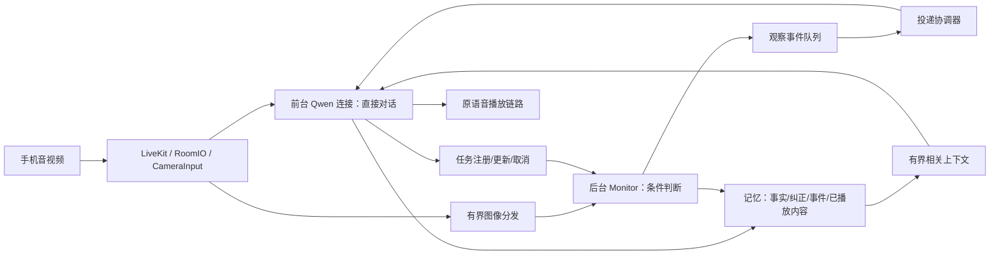

# M2 直接对话 + 独立后台观察与记忆：下一阶段开发与验证方案

日期：2026-11-02（Asia/Shanghai）。状态：已确定总体路线的开发交接文档；本文没有实现新功能、启动服务或执行付费媒体验证。

## 1. 已确定的方向与交付范围

保留 M2 的直接音视频对话路径，独立增加后台观察、事件投递与记忆。普通问答不再强制经过当前 H2 的 DECIDE → 工具回填 → SPEAK。模型负责语义理解，Harness 负责可确定检查的状态、调度和执行约束。

本方案是下一阶段的主路线，旧 `harness-implementation-plan.md` 的 H3/H4/H5 不再作为必须顺序完成的主线；其中的取消、证据、播放与清理要求仍可复用。旧文档和结果保留，不把路线调整写成旧阶段已验收。

本轮用户只要求编写方案。新会话按本文推进开发与验证，不在本轮改运行逻辑、默认配置或现有服务。

### 1.1 范围

- 单用户、单 LiveKit 通话；前台与后台默认使用同一 Qwen 模型型号、同一已选提供商。
- **明确调整原来单活动连接的限制**：允许一个前台连接和一个按需启动的 Monitor 连接；各连接内部仍有序发送、最多一个活动生成。两个连接不等于两个模型型号。
- 首个主动场景：用户交代一次“看到指定物品就提醒”，之后沉默，目标出现时提醒；随后扩展连续物品介绍。
- 首版后台只接摄像头图像，用合成静音完成必要的媒体协议提交；真实环境音频条件监控后置，避免一开始引入语音副本和回声问题。
- 记忆先实现当前任务、用户纠正、重要事件、已讲内容和跨连接恢复；再验收可管理的跨通话文本记忆。
- 保留手机原 HTTPS 入口、设备控制与 M2/H2 回退入口。
- 首版不引入独立 STT/TTS、通用多 Agent、联网业务工具、向量数据库或额外的记忆整理模型。记忆压缩先提供可替换接口，不默认增加另一个付费模型。

### 1.2 不作为首版交付承诺

多人身份绑定、任意噪声中的自然交互、操作自动完成与纠错、快速动作可靠捕获、无限期原始媒体记忆、无感断线恢复、固定 1–3 秒主动提醒，均须另行验收。

## 2. 当前代码和验证基线

以下是 2026-11-02 工作区检查结果，开发开始时需再次核对。

| 部分 | 当前情况 | 本路线处理 |
| --- | --- | --- |
| `providers/qwen_realtime.py` | M2 持续送音视频，供应商语义 VAD 自动回答；已支持显式 `generate_reply` | 作为直接对话基础，不能假定已经支持事件/记忆注入 |
| 同文件 `update_tools` / `update_chat_ctx` | 工具尚未开放；不支持重建远端历史 | 分别建立协议门槛和适配，不能只更新本地 ChatContext |
| 同文件 generation 事件 | 函数流当前为空，回答来源只有有限标识 | 增加用户/事件/工具续答关联，避免接错生成 |
| `providers/qwen_harness.py` | 单连接受控生成；`checks_enabled=False`，指导仅接受 `user_reported` | 保留旧模式，复用协议和取消经验，不把整个受控流程搬进前台 |
| `media/video.py` / `media/camera.py` | 最新帧、有界缓存、镜头 epoch 与异步编码 | 增加非阻塞媒体分发；不得让 Monitor 消耗掉前台待发送帧 |
| `worker.py` | 装配模型、RoomIO、摄像头；H2 跟踪服务端播放完成 | 新模式装配协调器，补齐前台实际播放关联 |
| `config.py` / `session.py` / `api.py` / `web/src/main.js` | 模式与页面任务控制绑定 legacy/H2 | 增加独立的新模式标识和能力状态，不借用手动录音标识 |
| `scripts/run_local.py` | `--harness` 启动 H2 | 增加显式新模式入口，不修改旧开关含义 |

验证现状：M2 固定视觉样例和设备控制有通过记录；手机真实通话与 20 物品验收未全部完成。最新 H2 自动输入普通问答单测链路通过，连续介绍/控制检查通过，但完整脚本在任务后问答完成处超时，不能写成整套通过。手机实物、回声和长会话仍待验收。

阅读记录：`m2-verification.md`、`harness-auto-input.md`、`harness-auto-input-results.json`、`harness-showcase-ack-coalescing.md`、`harness-h2-verification.md`、`protocol-findings.md`。

开发开始时检查 `git status`。本次观察到提供商配置、客户端和测试等已有未提交修改，README 也已有修改；这些不属于可清理的临时文件。保留并理解现有修改，不覆盖或回退。新模式的能力记录必须绑定实际提供商、Endpoint 类型、模型 ID 和日期；阿里云结果不能自动赋给一步 API。

## 3. 架构与职责



### 3.1 前台

- 保留音视频流式输入与供应商语义轮次，普通问题直接语音作答。
- 用户明确要求监控时，模型调用任务创建工具；工具只做实际注册，不要求所有普通问答调用决定工具。
- 接受带来源的后台事件和相关记忆；两者都是数据，不是新的用户指令。
- 不因 Monitor 正在推理而等待；优先处理用户开口和取消旧输出。
- 前台用户语音优先，首版主动提醒不抢断现有对话。紧急纠错的抢占策略另行设计。

### 3.2 Monitor

- 按任务条件读取近期图像，模型判断 `matched / not_matched / unknown`，给出简短观察依据。
- 默认不输出面向用户的语音，不持有播放权限，不调用业务工具，不修改前台对话历史。
- 场景差异只作调度线索，不把像素稳定等同于展示意图，也不把像素变化等同于换物。
- 可在前台讲话时继续观察；与前台竞争的网络、编码、供应商限流和费用仍需测量。

### 3.3 Harness

- 管理任务版本、连接版本、缓冲、预算、队列、冷却、取消和播放回执。
- 验证事件是否新鲜、来源有效、仍属于活动任务；不以手写物体规则替代模型语义判断。
- Monitor 故障隔离为“观察不可用”，前台可继续问答。前台失败则结束/暂停相应通话任务，不让后台变成孤立常驻任务。

## 4. 必须先验证的协议门槛（P0）

每项写 `unknown / passed / failed`，保存脱敏事件及使用量。文档支持、配置回执和真实行为通过分开记录。不通过时可继续独立离线工作，但不能宣称对应功能已接通。

| 编号 | 固定输入探针 | 通过证据与失败处理 |
| --- | --- | --- |
| P0-A 双连接 | 同型号前台持续问答，Monitor 独立看固定新图；断开 Monitor | 前台继续回答，事件/音频不串线；记录并发限额及两连接用量；失败先交付独立记忆/离线骨架 |
| P0-B 图像观察 | text 初始化的独立 Monitor，分块新图 + 协议静音，显式提交和生成 | 能在红/蓝或有/无目标切换中返回当前依据；静音不进入用户转写/轮次；失败暂停 Monitor 接入 |
| P0-C 结构化结果 | 约定的小 schema 或完整工具调用返回 | 严格解析、区分 negative/unknown、截断/错误不触发；最多一次有界纠正，仍失败记观察失败 |
| P0-D 事件注入和发声 | 无工具前台接收引用化事件，等待确认后显式请求响应 | 真实语音正确引用事件；不伪造用户语音、不伪造 call_id；测试过期事件、空响应及工具意外返回 |
| P0-E 自动轮次竞争 | 在注入/生成/播放各阶段送入真实固定用户语音 | 无双重生成、错配或吞掉用户轮次；按下述调度选择规则决策 |
| P0-F 任务工具 | 直接问答与创建/更新/取消工具混合 | 普通问答不必调用工具，真实调用仅执行一次；先 UI 可验证，再开放自然语音任务注册 |
| P0-G 记忆回注 | 写入一个事实并纠正，恢复到新连接，问该事实 | 使用最新事实、不重复讲话、不执行记忆中的指令；确认恢复项目已生效，不能用本地记录代替 |
| P0-H 预算与提供商 | 同时运行两连接，检查实际调用/用量事件 | 配额与费用可计数，认证失败不重试风暴；每个提供商分别记录结果 |

### 4.1 前台调度选择规则

先保留 M2 当前自动响应，验证 P0-D/E：收到有效事件后，只在用户静默、无活动生成、无未完成工具回执且播放已结束时注入和生成。

若自动 VAD 与显式事件响应竞态无法可靠关联，再探测官方实现采用的组合：供应商 `semantic_vad` 检测轮次，`create_response=false`，由协调器在合法用户提交后直接请求一次响应；`interrupt_response` 的实际行为另验。不增加普通轮次的内部 DECIDE。当前 `QwenClient.configure` 尚未暴露这些字段，新增必须可选且不改变 M2 默认。

这是可选择的薄调度方案，不能未经验证就关闭自动回答，也不能退回本地 VAD + 每轮 DECIDE 作为隐式兜底。转写完成、speech_stopped、音频 commit 不是同一种事件；依探针确认哪个真实事件可触发用户响应。

若两种调度方式都不可靠，暂停前台事件发声，保留事件文字状态及直接问答，不暗中切回整套 H2。额外的专用播报连接作为后续选项，须单独验证音频仲裁、费用与记忆一致性，不作为首版自动回退。

### 4.2 记忆与事件传输门槛

优先验证独立的引用化上下文项。不能根据通用兼容协议推断当前提供商支持任意 `conversation.item.create` 消息、删除/替换历史项或 response 级 instructions；当前公开文档对工具回填的支持也不等于普通消息回注已通过。

若消息回注不支持，可探测 `session.update.instructions` 中固定策略 + 有界数据快照：保留原策略，明确数据来源，空闲时整体替换；需确认更新不丢失历史、不更改工具/音频且不立即触发回答。不得逐帧更新系统提示或无限追加摘要。

两种方式均不通过时，只交付本地记忆存储/检索，标明“前台使用未接通”。不能为注入方便伪造函数调用结果。

## 5. 最小数据契约（应用侧，不是供应商 API 字段）

### 5.1 任务

```text
ObservationTask:
  task_id, revision, call_id, source_user_item_id
  kind: condition_monitor | live_narration
  goal, condition, selected_source, modalities
  status: active | paused | completed | cancelled | failed
  repeat: once | repeat_on_reentry
  cooldown_ms, created_at, expires_at
```

首版最多一个活动观察任务；重复工具调用幂等；修改条件增加 revision 并清除旧事件。UI 请求是明确用户操作；语音创建必须来自当前真实用户轮次的有效工具调用，模型口头承诺不等于任务已创建。后续可使用类似官方的任务工具名称，但名称本身不提供实现。

### 5.2 观察结果和投递

```text
ObservationResult:
  observation_id, task_id, revision, call_epoch, monitor_epoch
  camera_epoch, frame_ids, sampled_at_mono, evaluated_at_mono
  result: matched | not_matched | unknown
  observation_summary, evidence_summary, uncertainty

ProactiveEvent:
  event_id, observation_id, task_id, revision, call_epoch
  created_at_mono, expires_at_mono, dedupe_key
  observation_summary, evidence_summary
  delivery: queued | preparing | speaking | delivered | interrupted | expired | dropped | failed
```

ID 由程序绑定，不接受模型自造来源。模型自报置信度不是校准概率。`matched` 是模型观察，不自动成为事实或任务完成证据。

一次任务在事件接受后标记监控 completed，停止重复检测；是否成功播完单独记录。completed 仍允许投递该版本已经接受的一次事件，cancelled/failed、版本变更或事件过期则不允许；不能因监控已完成而把唯一提醒误丢弃。重复任务采用 negative 后重新进入或明确的新事件变化再触发；unknown 不当作 negative 解除去重。冷却到期本身不能让相同正例再次提醒。

### 5.3 记忆

```text
MemoryRecord:
  memory_id, library_id, kind, content
  source: user_reported | model_observation | application_event
  source_ids, call_id, task_id?, observed_at, updated_at
  validity: current | historical | superseded | uncertain
  supersedes?, expires_at?, evidence_refs?
```

至少区分：当前任务状态、用户明确事实/纠正、历史观察、已播放内容。新连接只能恢复摘要中的历史认识，不能声称仍拥有原音视频感知。镜头切换使当前视觉证据失效，不删除历史观察，也不自动取消用户的寻找目标任务。

## 6. 后台采样、预算与确认策略

- 首版起点：1 FPS，最多两秒一个观察片段，滑动缓冲最多十秒图像且加总字节上限；不足完整片段不伪造动作证据。具体分包先以 P0-B 验证为准。
- 每个 Monitor 只保留当前推理与一个最新待处理片段，慢推理替换旧待处理片段，不积压沿途所有画面。
- 图像编码和分发不得阻塞前台音频；优先复用不可变编码帧。前台/后台各自持有消费游标，不能共用 destructive `take()`。
- 无任务不启动 Monitor、不发送副本；暂停停止观察，继续从新画面开始。摄像头关闭清空在途视觉证据、撤销相应待投递事件，通话语音继续。
- 低变化只允许退避，仍保留有界周期检查，不能过滤掉缓慢液位变化等目标。
- 默认试验预算：后台最多 20 次生成/分钟（含纠正），单次超时 10 秒，连续 3 次失败暂停；预算退避不堆积媒体。该预算限制可能使持续两秒检查无法全部执行，必须记录实际跳过/等待，不承诺固定检测周期。
- 前台和后台共享供应商总配额计数；后台保留前台余量。实际限额先按所选部署验证，配置可覆盖；不要给前台每次普通发言加新的硬工具门禁。
- 初版事件图像最大投递年龄建议 5 秒，从最后依据帧服务器接收单调时间算起，另记录两秒片段的最早时间。超时可重观察或丢弃，不能把旧观察包装成当前画面。慢推理导致高丢弃率也算体验问题。
- 工程有效性检查始终保留：帧龄、版本、取消、重复、连接、输出来源。它们不需要另一次模型调用。
- 普通目标提醒和物品介绍默认一次语义判断；不固定要求停留 + 两次识别。不确定返回 unknown，按预算补采样。
- 相似主体、遮挡和证据冲突可以再观察；自动操作推进另验，不复用普通介绍的宽松策略。
- 模型条件判断与前台口语组织可以是两次必要生成，但前台不默认再做相同的识别。叙述的新信息去重由语义摘要加应用已播放记录完成，像素比较只提供线索。

## 7. 投递、竞争和播放一致性

1. 校验结果来源、任务 revision、连接/镜头 epoch、新鲜度及去重。
2. 等用户静默、前台无生成/工具回执、旧播放已结束；建议 600ms 静默作为调参初值，不改变供应商断句。队列最多 4 项，合并同任务过时事件，过期丢弃。
3. 注入引用化报告，等相应确认后发起一个关联 `event_id` 的响应；仅表达报告支持的事实，不补造当前视觉细节。
4. 注入或等待确认期间用户开口：用户优先，未投递事件延后；已开始生成/播放则取消主动输出，丢弃迟到音频。若注入项已进历史，记录“未播出/已过期”，不假装已撤回。
5. 只有生成成功且对应播放正常结束才标 delivered；被打断不自动重播，不加入“已讲过”记忆。可以保留带状态的观察历史。
6. 首版沿用 server_playout 并明确它不证明手机听见；最终真人验收结合手机听感。将来加入客户端回执再单独声明 delivered 的新口径。

每个响应必须有明确来源 `user / proactive / tool_continuation` 和关联 ID。不能让 Monitor 的 response.created 占用前台 `_pending_reply`，也不能把用户新轮次误绑定为事件响应。无音频、意外工具、失败和取消都不能记为已提醒。

控制参数错误可以有界处理；前台事件表达失败首版不自动增加另一条播报链路，记录 failed，允许用户查询状态。

## 8. 记忆实施顺序

### 记忆 A：明确状态和本通话事件

先直接保存应用事件及已有模型转写，不为每轮增加总结生成。任务状态保留在内存；其他记录有界存放。用户明确纠正通过 UI/已验证工具更新优先事实；不要用关键词误判一切自然语言为纠正命令。

建议初值：内存最近 32 条对话/事件，当前最多 16 条重要事实；检索回注最多 8 条、总计 3000 字符。预算不是无限记忆承诺，拒绝无界追加。缺少可靠转写的语音事实不能声称已提取成功。

### 记忆 B：连接恢复与跨通话文本库

使用项目内 `.runtime/memory/<library_id>/` 的本地文本/SQLite 存储，实现写入、纠正、检索、禁用与清空测试库；不提交个人内容。匿名通话默认隔离，用户显式选择同一 library 才跨通话复用，不把所有房间当成同一身份。

先使用词法检索与任务/时间筛选。相关记忆在前台生成前需要可用，但检索应有时间预算并复用快照；不能在每轮首音前等待云端总结。检索失败返回“记忆暂不可用”，不清空库、不编造历史。

更新/删除/禁用后，未来快照排除相关记录；已送入当前模型上下文的内容不能承诺被遗忘。若无已验证的删除协议，在空闲边界重建连接；重建前标明 pending，不能仅删本地数据就宣称云端已忘记。

### 记忆 C：有损压缩与长会话（后续门槛）

只有明确记录不足时，再增加空闲压缩。使用同型号独立短连接也会增加连接数、费用与并发，须单独配置上限与验收；首版不默认启动。其他型号的 updater 或 embedding 是后续选项。

根据已验证的用量/长度边界决定何时准备摘要和新连接，不能只等媒体记忆丢失后补救。摘要生成不等于已更新前台上下文；新连接需恢复固定策略、工具、有效任务、纠正和近期文本并确认后接管。忙碌时不切换；恢复失败保留旧连接或明确提示，不能重放旧媒体/旧通知。跨连接语音不中断不作为首版承诺。

原始媒体默认只在内存短期缓冲，首版持久库只存文本和来源元数据。需要长期关键帧时单独说明范围和清理策略，不因“做记忆”默认保存摄像头/麦克风内容。

## 9. 建议代码落点与迁移

以下名称为建议，尚不存在；优先小模块、可替换接口，不必照目录拆成服务。

| 落点 | 内容 |
| --- | --- |
| `providers/qwen_live.py` | 新前台适配/工具与事件注入，复用 M2 音频映射，不继承整套 H2 强制决定策略 |
| `observation/monitor.py` | 独立客户端、媒体提交、结构化观察及超时 |
| `observation/tasks.py` | 任务、修订、去重与暂停/结束 |
| `coordination/delivery.py` | 前台调度、用户抢占、来源关联与播放状态 |
| `memory/store.py` / `context.py` | 有界记录、持久化、纠正、检索与快照 |
| `media/video.py` 或独立 fanout | 不阻塞的编码帧分发、各消费方独立游标 |
| `config.py` / `worker.py` / `session.py` / 页面 | 显式能力状态、新模式装配、最小任务控制 |
| `scripts/probe_live_background.py` | P0 固定样本、超时、用量与脱敏报告 |

模式建议新增 `direct_background`，保留 `legacy_auto` 与 `controlled_manual`，只在新会话创建时选择。新增启动参数/脚本须明确写入对应模式，原 `--harness` 仍指 H2。观察和记忆可以独立关闭。README 标明真实入口，计划中的命令在实现前不能作为可运行命令发布。

尽量复用现有 `OutputGate`、帧新鲜度和播放回执，保留已验证行为；不要复制两套媒体编码器，也不要为了新模式清除旧测试。

## 10. 分阶段开发与验收

| 阶段 | 交付 | 进入下一阶段的条件 |
| --- | --- | --- |
| D0 基线与协议 | 固定 M2/H2 基线，P0 探针、能力矩阵，离线任务/事件契约 | 明确事件注入和调度可行路径；失败如实记录，可先做独立存储 |
| D1 直接对话骨架 | 新模式保持 M2 直接回答，媒体分发、取消/清理；不启用主动语音 | 原问答/追问/换物/插话不退化，无强制决定工具 |
| D2 独立视觉提醒 | UI 创建一次监控，后台判断，合规事件投递 | 用户沉默可提醒，问答不中断，故障隔离、过期/重复受控 |
| D3 自然语音任务 | 模型创建/更新/取消工具，普通问答仍直接 | 一次真实请求可启动；暂停/继续/结束可靠，不靠转写关键词执行 |
| D4 记忆闭环 | 有界记录、纠正、回注、新连接与选定库跨通话恢复 | 能正确使用历史并区分当前视觉，禁用/删除边界可说明 |
| D5 连续介绍与手机 | 增量新信息、去重、真人插话、长会话与性能对照 | 满足下述完整案例并完成手机验收；不据此宣称操作自动指导完成 |

每阶段写 `docs/direct-background-dN-verification.md` 与同名 JSON，列出通过/失败/待验、固定输入、提供商配置、代码版本/工作区差异、命令、样本数、用量和残留资源。D1/D2 可先于记忆完成，不把所有功能一次堆进 worker。

### 10.1 必测案例

| ID | 输入/故障 | 必须看到的结果 |
| --- | --- | --- |
| Q1 | 普通看图问答、追问、立即换物 | 直接语音回答，无每轮决定工具；新画面不沿用旧物 |
| Q2 | Monitor 正在推理时用户提问 | 前台立即走自己的响应路径；无串线或双重生成 |
| O1 | “看到钥匙提醒”，先杯子再钥匙 | 杯子安静，钥匙出现后一次有效提醒 |
| O2 | 相似物/模糊/遮挡/短暂扫过 | 区分 negative/unknown，记录漏判与误判；不以一律沉默算成功 |
| O3 | 目标一直停留，离开后再出现 | once 不重复；repeat_on_reentry 按条件重新触发 |
| O4 | 模型正例晚到、镜头关闭/切换、修改条件 | 旧事件失效，不介绍过期画面 |
| O5 | 移动中目标短暂出现、缓慢画面变化 | 记录捕获边界；不被稳定过滤永久挡住 |
| D1 | 用户在注入、生成、播放阶段开口 | 用户优先，旧音频不泄漏、事件响应不冒充用户轮次 |
| D2 | 前台长时间忙碌，多个重复事件 | 有界合并/过期，不在稍后连续补播旧提醒 |
| D3 | 服务端生成完成但播放未结束 | 不抢播下一条；未播放完不记已讲 |
| T1 | 同任务工具重复、坏参数、无有效调用 | 幂等/拒绝；普通问答不因未调用工具被拦截 |
| M1 | 用户事实、随后纠正、再次询问 | 使用最新纠正，保留来源；不合并到其他测试用户 |
| M2 | 更换前台连接、重新加入同一测试库 | 事实与有效目标按产品规则恢复，旧事件不重播，历史图不当当前图 |
| M3 | 禁用/删除记忆、库检索失败 | 状态准确；必要的连接重建可见；不声称已撤回云端历史 |
| N1 | 三件物品连续介绍，换角度和停留 | 一次启动，不重复旧信息；未播完不算已讲 |
| F1 | Monitor 超时/断线/限流、内存队列满 | 有界暂停/退避，前台问答可继续 |
| F2 | 前台断线、挂断、页面关闭、等待回执时取消 | 所有所属连接/timer/队列/缓冲释放，无后台孤儿任务 |

### 10.2 指标和比较口径

- **问答延迟**：固定输入的已知语音结束 → 远端解码首个非静音音频；另记录供应商轮次确认 → 首包，避免混淆端点与生成耗时。
- **主动提醒延迟**：人工/脚本标注的条件首次满足 → 手机/浏览器首音；分别报告采样等待、Monitor 推理、投递排队和前台语音生成。
- **判断准确性**：按独立 episode 统计命中、漏报、误报、unknown；不能按相邻重复帧凑大量样本。标注由固定场景或人工完成，不用模型自己的时间作正确性基准。
- **记忆**：正确召回、纠正覆盖、错误合并、历史/当前混淆、跨库泄漏和恢复失败。
- **运行成本**：前后台分别记录连接时长、生成次数、tokens、估算费用、过期丢弃率和队列高水位；检查两连接对总网络的影响。
- 比较 M2、当前 H2、新模式关闭 Monitor、新模式开启 Monitor。使用相同输入、模型/提供商、网络和输出长度约束；条件不同必须说明，不套用旧样本作严格 A/B。
- 延迟每条件至少 20 个有效样本，再报 p50/p95、最大值和失败数；超时单列，不能从总体成功率中消失。小样本只报原值，不声称稳定分布。
- 初版功能目标：清晰条件的 20 个正例 episode 至少 18 个正确提醒，20 个负例 episode 零误提醒，已处理目标持续停留零重复；复杂样例另外分组，不能混成“复杂场景通过”。这些是建议验收门槛，不是现有性能结论。
- 普通问答拟定非退化门槛：相对同轮 M2 的 p50 增量不超过 300ms、p95 增量不超过 500ms；若超出，保留实现但标性能未通过并分析竞争环节，不为达标删失败样本。主动提醒先建立基线，1–3 秒仅作探索目标。
- 手机验收覆盖耳机/外放、句中停顿、附和/真正插话、前后镜头、关摄像头后语音、暂停/继续/结束、结束后普通问答，以及至少 20 分钟无资源增长的通话。

## 11. 回退和开发约束

- 旧 M2、旧 H2 可显式启动；新模式失败不自动切换到它们，避免用户看到功能语义突然变化。
- 按功能关闭 Monitor/记忆即可降级到直接问答。关闭观察停止所属连接、清队列；关闭记忆不等于删库或抹除已送远端的内容。
- 不覆盖 `.env`、已有手机 profile/证书/防火墙，也不自动改模型提供商。开发先记录当前配置中的非敏感选项。
- 探针用固定非保密绘图/合成语音，不默认使用物理设备；真实云端调用限定次数、时长、用量，无无限重试。执行新会话已有授权范围内的验证，新增范围先明确。
- 原始音视频不默认落盘；日志保留关联、耗时和错误类型，不打印密钥、Base64 或完整个人记忆。
- 每次通过必要回归后进入下一步，不重复付费大回归只为增加成功次数。协议失败不能靠吞掉内部错误或播放等待提示冒充首音解决。

## 12. 官方依据与已知不确定性

2026-11-02 查阅：

- [Qwen3.8 论文 §7.3](https://arxiv.org/html/2609.25611v1#S7.SS3)：说明独立实时监控会话、事件报告及持久记忆的系统路线。它支持前后台分离的设计依据，不证明本项目协议已接通。
- [官方仓库开发文档](https://github.com/QwenLM/Qwen-Live-Harness/blob/main/packages/qwen-live-harness/README.md)：提供前台、Monitor、投递和记忆模块的参考；本方案只借鉴职责分工，接口兼容性按 P0 实测。
- [官方配置说明](https://github.com/QwenLM/Qwen-Live-Harness/blob/main/docs/configuration.md)：Monitor 独立于前台 Live Feed，提供采样和配置参考。本文预算和验收阈值是本项目建议值，并非官方保证。
- [客户端事件](https://help.aliyun.com/zh/model-studio/client-events)、[实时调用](https://help.aliyun.com/zh/model-studio/realtime)、[模型信息](https://help.aliyun.com/zh/model-studio/qwen3-8-omni-flash-realtime)：核对配置、提交、生成及上下文限制。开发时按选定提供商复核。

Qwen-Live-Harness 中后台也是模型在理解条件，不能写成 Harness 用硬规则完成全部语义判断、前台仅充当 TTS。SeedRealtime 的公开原生交互说明也不能用于推断其产品没有任何运行控制。

VAD 静默超时与视觉条件提醒不是同一机制；不把其他 Qwen 版本的 `idle_timeout_ms` 直接用于当前 3.8。官方案例、架构和配置都不是本项目真实手机验收结果。

## 13. 给新会话的开发指令

可以复制以下内容：

> 请阅读 `docs/m2-background-observation-memory-plan.md`，以“M2 直接对话 + 独立后台观察 + 独立记忆”为主线开始下一阶段开发。先检查仓库指令、工作区现有修改、M2/H2 最新验证记录和提供商配置，不覆盖已有工作。保留普通问答直接响应，不把所有轮次纳入 DECIDE/SPEAK。允许同型号模型的前台与 Monitor 两个独立连接，先实现视觉目标提醒，再逐步接入自然语音任务工具和记忆。第一轮完成 D0 协议探针/能力矩阵及 D1 可测试骨架，在已有授权范围内做有界固定媒体验证；按 P0 结果选择事件注入、前台调度和记忆回注方式。未通过的能力保持 unknown/failed，不臆造供应商字段，不因官方有实现就假定当前接口兼容。后台失败不得阻塞前台；二次语义确认按证据选择，工程版本/新鲜度/取消检查始终保留。普通问答与主动提醒分别计时，保留所有失败及手机待验项。每阶段写通过/失败/待验证报告，并提供 M2/H2 回退入口；不要一次实现全部高级场景。
