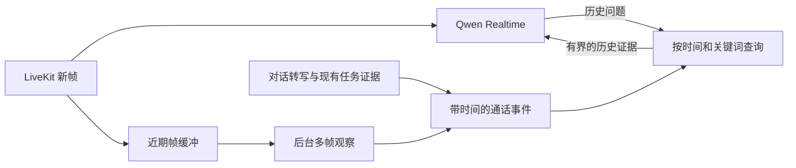

# LiveKitAgent 官方模式记忆设计

首版目标是让用户在同一场视频通话里随时问「前面出现过什么」「刚才发生了什么」「先后顺序是什么」。即使当时没有发起问答、教学或提醒，系统也应在采样和预算允许的范围内记录画面变化。通话历史在进程内保存，挂断释放。跨通话记忆排到后续阶段。

## 两个参考方案

### Qwen Live Harness

本项目锁定 `qwen-live-harness@1.0.0`。以下结论核对了本机安装包，并与上游对应模块对照。 [依赖版本](../harness/qwen-live/upstream.json)

- **写入与整理**。对话转写按轮次和片段保存。模型可以用 `omnibio` 更新通话内工作记忆，挂断后独立的整理模型再将工作记忆整理成长期用户资料和带时效的近期事项。可选的视觉观察器默认关闭，启用后默认每 60 秒从选定画面提炼一段文字。 [会话记忆](https://github.com/QwenLM/Qwen-Live-Harness/blob/main/packages/qwen-live-harness/src/memory/session.ts) · [整理器](https://github.com/QwenLM/Qwen-Live-Harness/blob/main/packages/qwen-live-harness/src/memory/updater.ts) · [配置](https://github.com/QwenLM/Qwen-Live-Harness/blob/main/docs/configuration_ZH.md#memory让对话有记忆)
- **检索与回注**。开场预载有字数上限的用户资料和近期事项。需要查更早的对话或视觉记录时，模型调用 `omniretrieve`。本地 SQLite 全文检索与可选向量检索联合召回。对话按两路排名和时间线索排序，视觉记录优先词法匹配。结果通过带版本号的静默记忆快照进入实时会话。 [预载](https://github.com/QwenLM/Qwen-Live-Harness/blob/main/packages/qwen-live-harness/src/memory/preload.ts) · [检索](https://github.com/QwenLM/Qwen-Live-Harness/blob/main/packages/qwen-live-harness/src/memory/retrieval.ts) · [模型工具与快照](https://github.com/QwenLM/Qwen-Live-Harness/blob/main/packages/qwen-live-harness/src/memory/tools.ts)
- **对本项目的判断**。首版主要借鉴按需查询与静默回注。按分钟提炼单帧适合回忆大致环境，采样间隔内的短动作和动作顺序容易丢失。通话内视觉历史需要连续处理有界的多帧片段，已有任务证据可补充通用观察。

### StreamVibe-Harness

依据 arXiv v2 的第 4.1 节、附录 C 和实验附录。作者项目页尚未提供可核对的 Harness 源码。 [论文](https://arxiv.org/html/2610.34662v2) · [项目页](https://stream-vibe.github.io/)

- **交互状态**。持续维护活跃意图、已观测的任务进度和已送达的回复。每个意图独立更新。持续提醒命中一次后只结算该次事件，后续事件仍可触发。历史回忆只能提供背景，状态变化由对应的新证据或用户输入支撑。
- **视觉记忆**。近期帧保留细节，中期摘要记录带时间的实体、动作和状态变化，更早内容再合并成文本块。论文的分块实验使用约 32 秒一块、每 5 份中期摘要合并、最多保留 8 个历史块。摘要异步处理提交时已见到的帧，合并失败时保留原摘要的拼接。这里的长期层服务于长视频中的历史追溯。
- **检索与使用**。以当前问题、任务条件和进度作为查询，用词法重合与时间线索筛选，分别取事实和有序变化，最多各 3 条。论文实现只用词法索引。历史证据附带时间，当前观察优先。附录 A.3 的轨迹评测中，RL 模型接入整套 Harness 后，动态意图的 Content-F1 从 5.25 升至 8.91，隐式意图从 10.65 降至 10.17。这组结果同时包含状态管理、记忆和上下文组织的影响。 [论文附录 A.3 与 C](https://arxiv.org/html/2610.34662v2)

## 项目设计

当前主线是 `qwen_live_official`。Python Worker 把通话媒体桥接到 Node，普通视觉输入约为 1 FPS。Node 已能接收最终转写、讲解和教学进度、提醒生命周期及浏览器播放回执。建议在 Node 收到帧的位置旁路采集视觉历史，让通话状态和记忆共享同一个生命周期。可参考 Python 侧已有的中英文词法查询。官方模式的真实百炼记忆回注仍待验证，早期 `direct_background` 的 P0-G 探针未执行。 [媒体桥接](../src/livekit_vlm_agent/official/bridge.py) · [官方入口](../harness/qwen-live/src/runtime.mjs) · [词法查询](../src/livekit_vlm_agent/memory/context.py) · [早期验证记录](direct-background-d0-verification.md)

| 内容 | 建议保存什么 | 有效范围 |
| --- | --- | --- |
| **近期视觉证据** | 短时间的采样帧及时间戳，供追问时核查最近的细节 | 按帧数、字节数和时长限制的内存缓冲 |
| **通话事件历史** | 出现过的主体、可辨认动作、场景和状态变化，以及相关用户转写。为每条记录关联时间区间和来源帧 ID | 通话内有界索引。原帧过期后仍可用事件记录回答。长通话再合并重复区间和压缩较早的事件 |
| **当前任务状态** | 生效的提醒条件、教学步骤、讲解目标和已播完的提醒。由现有调度器管理 | 当前通话。向历史提供事件，供模型参考 |



### 如何记住画面

- 首轮可用现有约 1 FPS 帧流做实验，近端缓冲先试 30–60 秒，后台以约 10–15 秒的窗口提炼出现过的主体、变化和动作顺序。刚开镜或画面明显变化时可提前处理，低频检查覆盖镜头稳定但物体发生小变化的情况。窗口、帧率和调用频率用固定视频测定。单个动作若落在采样间隔内，覆盖取决于是否有帧捕获它。
- 每个批次只使用提交时已收到的帧。按源帧时间排序，重复观察延长时间区间，变化单独记事件。带上通话 ID、镜头代次、源帧 ID、开始和结束时间及不确定性。镜头切换时封存前一段，允许在同一通话内追问那段历史。挂断后释放缓冲与索引，拒绝晚到结果。原始音视频仅在内存处理。
- 普通通话也运行通用观察。教学、讲解和提醒的已确认事件可补充索引。教学步骤完成沿用现有证据规则或用户确认。记录已播完的提醒时，要把 `deliveryId`、`outputId` 和浏览器完成回执关联起来，核心的 `acknowledgeDelivery` 也覆盖输出被抑制的路径。
- 摘要在独立的后台调用中完成，限制并发、等待队列和每通话调用量。处理滞后时优先保留近期证据与已确认事件，并保留历史覆盖缺口。摘要失败或相关区间尚未处理时，可在帧仍有效且预算允许时按需核查。

### 读取与回注

- 历史问题通过官方实时工具按需查询。先锁定本次通话，再用「刚才」「开头」「上一步」等时间线索和对象词筛选。对「都出现过什么」这类没有对象关键词的问题，按时间取分散的代表事件。结果附时间、来源和覆盖情况，按条数和字符限制回传。
- 先用固定历史探针验证百炼能在回答前调用工具，并使用对应结果。后台摘要发布若需要静默上下文，单独探测核心现有的 `sendBackendContext`。验证历史文字只作为证据，更新本身保持静默。普通当前画面问答继续直接走实时链路。
- 问「现在」使用新鲜画面，问「之前」使用历史证据。画面已关闭、采样漏掉或观察置信不足时，明确指出相应时段无法确认。供应商连接恢复后可重新查询同一 Node 通话进程内的索引，能力以断线回放验收为准。

## 开发与验收顺序

| 阶段 | 实现范围 | 验收 |
| --- | --- | --- |
| **1. 通话内视觉召回** | 先用固定事件验证百炼的查询和回传，再接入通用多帧观察、有界事件索引和语音问答 | 在普通通话中展示物品并移走，期间不发起问答或任务。之后问出现过的物品、动作、先后顺序和当前画面。验证镜头切换、摘要延迟、未出现物品的负例、挂断清理及新通话隔离 |
| **2. 通话内任务续接** | 加入教学、讲解、提醒的状态变化与送达结果 | 回放检验已完成步骤、换目标、取消后的晚到事件，以及被打断或静音时的播放状态 |
| **3. 长通话压缩** | 对照回放决定何时合并早期事件，以及是否扩充采样或检索 | 固定模型和媒体，对比记忆关闭和开启。分别统计记录覆盖率、命中后的回答正确率、顺序准确率、旧状态误用、普通问答首音 P50/P95 和后台调用量 |

首个验收故事是用户先展示一本书，再拿出红杯并把它移出画面，过程中保持安静。经过几轮无关对话、原帧超过短期保留窗口后，问「最先展示了什么」「杯子出现后发生了什么」「杯子现在还在画面里吗」。同一段视频用开关记忆两组测试，检验记忆带来的增量。

采样窗口和预算为建议起点。跨通话持久化在通话内能力验收后另行设计。

## 当前实现

百炼官方模式默认开启 `QWEN_LIVE_MEMORY_ENABLED=true`。`CallMemory` 保留最近 30 秒、最多 30 张带时间戳的采样帧。第 30 帧触发第 1–10 帧的摘要，第 40 帧触发第 11–20 帧的摘要。批次封存独立的帧引用，短期窗口继续滚动。停采或采集变慢时，尚未提交的帧在即将过期时也会封存，最后一批可以少于 10 帧。一个摘要在途，最多三个批次排队。超限丢弃最老的排队批次，记录缺口。 [窗口与批次](../harness/qwen-live/src/call-memory.mjs)

历史问题通过 `recall_call_history` 回传证据。近期问题以检测到用户开口时的快照为准，一次提交窗口内全部帧，结果带来源帧和时间。回看可与摘要并行，摘要未写入时也能回答。早期问题查文字历史，跨区间问题合并两层。每批文字先写入再异步生成向量，最多保留 240 条事件，时间范围内融合关键词和向量排名。向量请求失败时继续用关键词。挂断取消请求并清空本地帧、文字和向量。

普通视觉请求使用百炼工作空间的兼容 HTTP 接口，默认 `qwen3.5-flash`。向量默认 `text-embedding-v4`。模型名分别由 `QWEN_MEMORY_VISION_MODEL` 与 `QWEN_MEMORY_EMBEDDING_MODEL` 配置。两条视觉路径各有请求超时和用量限制，回看可与一个摘要并行，普通实时问答仍通过原来的 Realtime 链路。`yibuapi` 前台模式当前显示记忆关闭。 [HTTP 适配](../harness/qwen-live/src/memory-observer.mjs)

### 按任务、事件和对话轮次回查

手机试测中，用户在讲解结束后追问整段历史。回查成功提交了最近 29 帧，返回 7 条视觉记录。这证明工具取得了画面证据。查询没有任务边界，画面记录也无法证明对应内容已经播出。这个缺口也会影响教学进度、提醒送达和跨事件追问。

1. **统一通话时间线。** 视觉摘要和结构化记录使用同一套通话时间戳。最多保留 480 条对话、任务状态和播放事件，并关联任务 ID、用户轮次、模型响应或浏览器播放序号。教学进度标注由视觉确认还是由用户确认。已排队、开始播放、播完、播放中断和未播即取消分别记录。有声转写只在对应浏览器输出确认播完后作为已播内容返回。 [时间线](../harness/qwen-live/src/call-timeline.mjs) · [浏览器回执校验](../harness/qwen-live/src/host.mjs)
2. **先定范围，再取证据。** 明确秒数直接查对应范围。「刚才那次」「开始教学以后」先匹配任务或事件边界，「后来呢」可沿用上轮已解析的范围。存在歧义时返回候选。先按时间、来源和可用的任务 ID 筛选，再查文本或已有视觉向量。顺序问题保留重复出现和先后关系。近期画面按需回看。只查任务、对话或播放结果时，使用本地记录。 [历史查询与工具](../harness/qwen-live/src/call-memory.mjs)
   「刚才依次介绍了哪些物品」默认按最近一轮讲解任务查询有播完回执的记录，保留显式时间或任务约束。工具用用户原话兜底纠正误选的 `vision`。视觉查询的时间范围早于短期帧窗口时，会合并范围内较早的文字摘要与窗口回看，即便近期已有结果也会查询较早的部分。
3. **跨场景验收。** 本地测试覆盖原帧过期、重复讲解保留顺序、正在处理的旧问题保留自己的时间边界、实际播放回执以及中断后收到的迟到回执。手机试测可在同一通话里先展示，再讲解部分物品，穿插一次教学或提醒并打断一段语音。原帧过期前后分别追问「出现过什么」「讲过什么」「下一步之前发生了什么」「提醒有没有播完」和「后来呢」，检查范围、证据来源、顺序、延迟及额外回看用量。

### 手机复测与排查

1. 新通话依次展示白鼠标和黑笔各 3–5 秒，移开后立即问「刚才展示了什么」。这一步验证整窗回看，即使首批文字还没写入也应能回答已拍清的物品。
2. 等两件物品的帧都离开 30 秒窗口，再问「通话开头那个写字用的东西是什么颜色」。这一步验证文字摘要和语义召回。若想检查历史与当前画面的区分，再问「现在镜头对着什么」。

在 `.runtime/logs/worker.log` 中，`official_ready.memory=call_visual` 表示启用。`official_memory` 的 `phase=summary` 记录批次帧编号、耗时和覆盖缺口。`phase=query` 记录整窗帧数、回看状态、搜索类型和是否成功回传。`phase=usage` 单独记录摘要、回看和向量用量。诊断日志保留这些元数据。

```powershell
npm.cmd test --prefix harness/qwen-live
$env:PYTHONPATH='src'
.venv/Scripts/python.exe -m unittest discover -s tests -q
powershell.exe -NoProfile -ExecutionPolicy Bypass -File scripts/prepare-memory-fixture.ps1
.venv/Scripts/python.exe scripts/probe_call_memory.py --live
.venv/Scripts/python.exe scripts/verify_official_harness.py --memory-live
```

两条 `--live` 测试使用合成媒体并消耗模型额度。组件探针验证整窗证据以及过期后的文字语义召回，浏览器探针覆盖实际媒体与播放链路。旧版约 22.1 秒的数据来自逐帧发送的实时接口，留作历史记录。 [旧版浏览器结果](../.runtime/memory-probes/rtc-e795dcea-155f-403d-9574-6cb24004aa89.json)

本轮 Node 51 项、Python 189 项通过。两次真实百炼组件样本中，10 帧摘要用时约 1.22–1.34 秒，30 帧回看约 1.60–1.95 秒。原始帧过期后，用与中文摘要没有共同关键词的 `cool-toned shape` 召回蓝色圆形，用时约 0.28 秒。浏览器在开镜约 9 秒时发问，首批摘要尚未提交，10 帧回看约 1.36 秒，语音回答播放完成。真实手机物体、长通话和延迟分布仍需单独验证。 [组件结果](../.runtime/memory-probes/8a7624ef-5cb6-403a-9a86-9af906e52922.json) · [浏览器结果](../.runtime/memory-probes/rtc-aabefab1-cae2-4d49-a665-8785f36e6b48.json)
