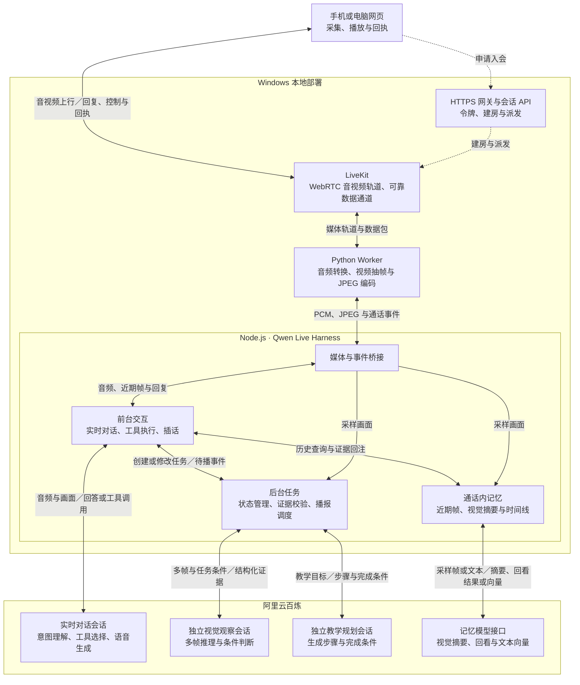
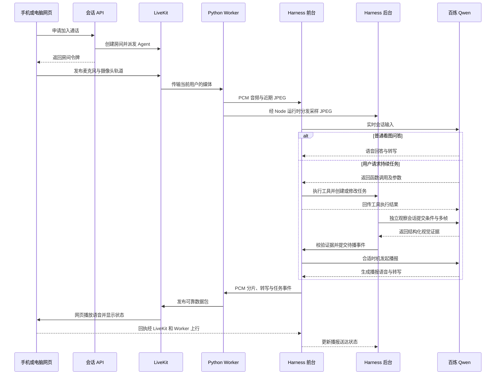

小艺看世界Demo是一款实时视觉语音助手原型。用户在手机或电脑网页里发起通话，可以一边展示物品或操作，一边向助手提问，也可以让助手持续讲解、分步教学或在满足条件时提醒。助手支持回忆同一次通话中看到、说过和完成的内容。

当前试测Demo方案将会话服务、LiveKit、媒体处理和任务编排部署在 Windows 电脑上，使用阿里云百炼完成语音与画面理解、回答生成和视觉观察。手机通过 HTTPS 网页接入。

## %%**技术选型与模块分工**%%

| 模块      | 负责的工作                                                                                                                          | 采用的技术                                                        |
| ------- | ------------------------------------------------------------------------------------------------------------------------------ | ------------------------------------------------------------ |
| 网页客户端   | 采集麦克风和摄像头，播放回复，显示转写和任务状态，支持点选主体和任务操作。                                                                                          | 原生 JavaScript、Vite 8.3.5、LiveKit JS SDK 2.23.0、Web Audio API |
| 会话服务    | 提供手机 HTTPS 接入，创建通话房间、签发加入令牌、派发负责处理通话的 Worker，并回收会话。                                                                            | Python 3.11、FastAPI、Uvicorn、LiveKit API SDK                  |
| 实时媒体传输  | 音频和视频分别通过媒体轨道上行。回复语音、转写、任务状态、用户操作和播放回执通过可靠数据通道传输。                                                                              | 自托管 LiveKit Server 1.13.11、WebRTC 音视频轨道及可靠数据通道               |
| 媒体处理    | 订阅当前用户的媒体，转换音频格式，对视频进行抽帧和 JPEG 编码。通过本地进程的标准输入输出把媒体与控制事件交给 Harness。                                                             | Python Worker、LiveKit Agents / RTC SDK、asyncio、Pillow、NumPy  |
| 对话与任务编排 | 前台维护对话并执行工具。后台管理任务状态、校验视觉证据、安排主动播报。项目固定 Harness 版本和构建标识，以保持其内部接口兼容。                                                            | Node.js 24.22.0、Qwen Live Harness 1.0.0、WebSocket            |
| 云端推理    | 实时对话、后台观察和教学规划分别使用独立会话，默认实时模型为 `qwen3.8-omni-flash-realtime`。通话记忆默认用 `qwen3.5-flash` 生成视觉摘要和回看结果，用 `text-embedding-v4` 生成文本向量。 | 阿里云百炼 Realtime 接口和兼容 HTTP 接口                                 |

## 系统架构图

## 一次持续讲解的数据与控制流程

以下用「接下来持续介绍我展示的物品」说明各模块如何协作。

1. **入会与采集。** 网页向会话服务申请入会。服务在 LiveKit 建房、派发 Worker 并返回令牌。Worker 启动本地 Harness，实时模型就绪后，网页发布麦克风音频。用户开启摄像头后再发布视频。
2. **媒体处理。** Worker 将语音统一为 16 kHz 单声道 PCM，每 20 毫秒一帧。视频常态每秒抽取一张 JPEG，保持比例并缩放到默认 640 × 480 边界内。语音进入前台。采样画面供前台问答、后台视觉观察和通话记忆使用。讲解启动、点选或明显转镜头时，可为讲解观察短暂升至 4 FPS，最长 2 秒。
3. **理解意图与执行工具。** 前台把语音与近期画面送入百炼实时会话。普通看图提问由模型直接回答。识别到持续讲解请求时，模型返回 `start_scene_task` 函数调用和任务模式、目标、讲解深度等参数。本地前台执行函数，后台建立任务，执行结果再返回模型。
4. **观察画面与判断。** 用户开始展示物品后，后台在独立的视觉观察会话中提交任务条件和新采样帧。云端判断画面主体或条件是否满足，返回结构化证据。本地检查证据来源、新鲜度和任务版本，再更新任务状态。
5. **调度与播报。** 确认主体后，后台将讲解内容排入播报队列。调度器等用户停止说话、当前模型生成和语音播放均已空闲，再发起前台播报。本地模型网关限制后台观察调用，并为前台对话保留生成额度。
6. **返回语音与确认送达。** Harness 将 24 kHz PCM 分片并标注输出编号和序号，经 Worker 和 LiveKit 可靠数据通道回到网页。网页显示转写，并在匹配结束标记且相应音频缓冲播完后发出完成回执。Harness 用回执区分已播完、播放中断和未播撤销，更新任务状态。
7. **结束通话。** 会话服务回收房间，Worker 关闭媒体订阅，Harness 停止任务并关闭模型连接。迟到的观察结果和播放回执按任务或会话标识校验。

## 音视频与任务数据流

## 后台任务如何运行

| 能力   | 云端推理与本地规则                                                                                                                                                    |
| ---- | ------------------------------------------------------------------------------------------------------------------------------------------------------------ |
| 持续讲解 | 云端根据两张新画面识别主体。本地维护主体和已播内容，用户可以通过点选纠正。用户说稍后展示时，系统优先等画面变化停稳再检查。明确转镜或确认换物后，撤销旧主体待播的讲解。                                                                          |
| 分步教学 | 前台用同一场景工具启动教学后，Node 另开一次云端文本规划，请模型生成 2 至 12 步。每步含一句操作指引和一条画面可核对的完成条件。第一步指引播完后，后台才开始检查该步骤。 视觉推进要求两次新的正向观察。用户明确说「这一步完成了」也可推进，确认绑定到开口时的步骤。视觉和口头确认同时到达时只推进一次。 |
| 条件提醒 | 云端根据多帧判断条件，本地保存触发条件、文案和重复规则。例如「桌上有红杯」核查当前状态，「红杯被拿走」要求前态和后态证据。重复提醒在确认条件退出后可再次触发。                                                                              |

## 通话记忆与测试复盘

- **近期与早期证据。** 近期缓冲保留最近 30 秒、最多 30 张采样画面。原帧即将移出窗口时按批交给后台视觉模型，生成带时间和来源帧的文字摘要。摘要放入有界队列，超出队列时记录覆盖缺口。近期回看可与摘要同时进行，普通实时问答保持原有连接。文字摘要先入索引，随后异步生成向量。较早的画面可在限定时间范围内按关键词和语义检索，向量失败时仍可查关键词。另有一条结构化时间线，记录用户转写、讲解主体、教学进度、提醒和播放结果。
- **查询内容与范围。** 前台通过 `recall_call_history` 查询指定时间、事件或任务中的证据。「刚才出现过什么」可以回看用户开口时已有的帧，也可查询较早的摘要。「刚才讲过什么」按讲解任务范围查询已经收到播完回执的内容。工具将证据返回前台模型，通话内记忆在挂断时释放。
- **可选测试记录。** 开启「记录本次测试」后，测试员可在手机通话里标记问题。挂断后，在电脑复盘页面按时间轴查看问答、播放、任务事件和送入 Harness 的 JPEG，可从一次误判追溯到对应视觉证据。测试文件单独留在本机，单次帧文件总量上限为 256 MiB。
